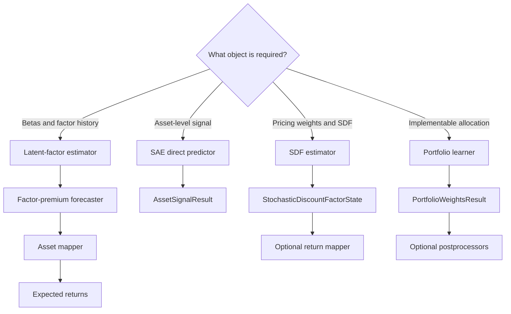

# Model Families and Selection Boundaries

The package separates models by the **financial object they estimate**, not by whether their implementation happens to use a neural network. This distinction determines the batch contract, the native result type, and what may legitimately happen next. A conditional autoencoder (CAE), for example, remains a latent-factor estimator because it emits betas and factor realizations; a supervised autoencoder (SAE) is a direct predictor because it emits asset signals. Likewise, stochastic discount factor (SDF) weights are a pricing object, while portfolio-model weights are implementable allocations learned under a portfolio objective.

## Selection map

| Family | Required batch | Native entrypoint and output | Core fitting assumption | Torch? | Correct next step |
|---|---|---|---|---|---|
| PCA / RP-PCA latent factors | `PersistentPanelBatch`; training needs a return matrix with stable asset identities | `fit()` then `extract()` → `LatentFactorState` | One persistent return column per asset; static cross-sectional loadings/betas | No | Forecast factor premia, then map `beta × lambda` to expected returns |
| IPCA latent factors | `CrossSectionBatch`; characteristics and training returns | `fit()` then `extract()` → `LatentFactorState` | Betas are linear functions of dated characteristics; alternating least squares identifies factor history and characteristic map | No | Forecast factor premia, then map betas and premia to assets |
| CAE latent factors | `CrossSectionBatch`; characteristics and training returns | `fit()` then checkpoint-aware `extract()` → `LatentFactorState` | Nonlinear characteristic-to-beta network plus linear factors from managed portfolios; optionally an ensemble | **Yes** | Forecast factor premia, then use an asset mapper |
| SAE direct prediction | `CrossSectionBatch`; characteristics and supervised returns | `fit()` then checkpoint-aware `predict()` → `AssetSignalResult` | Joint reconstruction and supervised asset-level loss on valid observations | **Yes** | Calibrate/rank/use the signal downstream; do **not** insert a factor forecaster |
| SDF estimation | `CrossSectionBatch`; characteristics and training returns, with optional context | `fit()` then phase-aware `extract()` → `StochasticDiscountFactorState` | Adversarial moment training estimates pricing weights and the SDF itself | **Yes** | Consume weights/SDF diagnostics, or use a separate expected-return mapper |
| Portfolio learning | `PortfolioSequenceBatch`; sequence features, and training returns | `fit()` then `predict()` → `PortfolioWeightsResult` | Learn scores or policies under predictive/portfolio objectives and normalize to allocation constraints | Linear baseline: no; LSTM/Deep: **yes** | Apply optional weight postprocessors, then hand weights to backtest/execution |

Torch is an optional runtime dependency supplied by the `deep` extra. The NumPy PCA, RP-PCA, IPCA, and linear portfolio baseline remain usable without it; CAE, SAE, SDF, LSTM, and deep portfolio implementations import Torch at runtime. See [Contracts and Public API](../concepts/contracts-and-public-api.md) for the supported protocol surface rather than coupling callers to implementation internals.

*The branch is selected by the native financial output; similarly shaped arrays do not make the branches interchangeable.*

## The three input contracts encode different economics

`PersistentPanelBatch` represents a stable-entity panel. Its `returns` is `(T, N)`, optional `characteristics` is `(T, N, C)`, and asset IDs—when supplied—must be unique and aligned with the fixed asset axis. PCA and RP-PCA enforce this concrete contract even though their common base accepts the `PanelBatch` union. At extraction they can reorder fitted parameters when the requested IDs are the same set in a different order, but reject a different identity set. This is not merely shape validation: their learned loading rows belong to persistent assets.

`CrossSectionBatch` represents dated, potentially ragged cross-sections. `characteristics` is required with shape `(T, N, C)`; returns, a validity mask, context features, timestamps, and slot IDs are optional at construction. IPCA, CAE, SAE, and SDF use the mask and finite-value checks to decide which date-local slots are observed. Here the slot axis need not imply a persistent entity through time. Training methods nevertheless require returns because each model's objective is supervised or return-pricing based; extraction/prediction can omit returns where the result does not mathematically require realized outcomes.

`PortfolioSequenceBatch` adds a sample dimension: features are `(B, T, N, F)`, with optional forward returns, volatility scaling, initial holdings, mask, group IDs, transaction costs, and adjacency. Training validation requires returns, while prediction needs features and whatever optional context a selected architecture/configuration uses. The result remains `(B, T, N)` allocation weights rather than collapsing to a dated cross-section.

## Latent-factor family: structural state first

All four structural estimators implement `BaseLatentFactorModel`: configuration and fitted state live on the model, `fit()` returns a `FitSummary`, and `extract()` returns `LatentFactorState`. That state enforces `asset_betas` shape `(T, N, K)` and, when observable, `factor_returns` shape `(T, K)`. It is deliberately not an expected-return forecast.

The family contains two different panel assumptions:

- **`PCAModel`** demeans a persistent return panel, fills missing centered observations with zero, takes an SVD, and broadcasts static loadings across requested dates. Training rejects an all-missing asset, insufficient panel rank, or `n_factors` above the panel limit.
- **`RPPCAModel`** eigendecomposes a risk-premium matrix built from the return second moment (the default) or covariance plus `gamma` times the outer product of mean returns. It derives factor-mimicking weights and time-series betas. Its sign, normalization, and optional orthogonalization choices are identification conventions, not downstream forecasts.
- **`IPCAModel`** augments each dated characteristic vector with an intercept and alternates between factor and characteristic-loading (`gamma`) estimation. Its final KPS normalization makes `gamma' gamma` identity, orders factor covariance, and pins signs while preserving fitted `gamma × factor` products. Dates with fewer than two valid training rows are omitted; extraction checks the fitted feature dimension.
- **`CAEModel`** constructs characteristic-managed portfolios, trains nonlinear beta and linear factor branches, and averages extracted states across ensemble members. It owns epoch checkpoints (including validation-best checkpoint `0` when available), and extraction can return either the ensemble mean or per-member states. A regression CAE can construct managed portfolios from returns; classification additionally requires `factor_returns` in the batch.

The intended orchestration is explicit in `LatentFactorForecastPipeline`: fit the structural model, extract training state, fit a `FactorForecaster`, then at prediction extract state, forecast factor premia, and invoke an `AssetMapper`. This is the only family among the four on this page for which a separate factor-premium forecast is the normal predictive continuation. See [Latent-Factor Forecasting](../workflows/latent-factor-forecasting.md).

## SAE: direct supervision, not latent state

`SAEModel` derives from `BaseAssetPredictionModel`, not `BaseLatentFactorModel`. It flattens valid characteristic/return observations and jointly minimizes feature reconstruction, main prediction, and auxiliary prediction losses. Regression uses mean squared error; classification clamps targets to `[0, 1]` and uses binary cross-entropy. The returned `AssetSignalResult.signal_values` has shape `(T, N)` and retains `NaN` for unavailable rows.

That autoencoder bottleneck does **not** establish the latent-factor contract: SAE exposes neither `asset_betas` nor dated factor returns, and its public operation is `predict()`, not `extract()`. Adding SAE to a `LatentFactorForecastPipeline`, interpreting its bottleneck as factors, or applying a `beta × lambda` mapper crosses the mathematical and API boundary. SAE checkpoints select a direct signal model; training also rejects fewer than two valid rows because its BatchNorm path cannot update on a singleton.

## SDF: weight-native pricing state

`StochasticDiscountFactorModel` accepts dated characteristics, optional context, and returns for fitting. Its phases are semantically meaningful checkpoints: first optimize the SDF network against unconditional moments, train a moment network adversarially, then optimize the SDF network against conditional moments. Validation may retain best-loss and best-Sharpe states in addition to scheduled `(phase, epoch)` checkpoints.

Extraction emits `StochasticDiscountFactorState.asset_weights` with shape `(T, N)`. If returns are present it also computes one `sdf_values` value per date using the paper-sign convention

`m_t = 1 - Σ_i r_(t,i) w_(t,i)`.

Masked or nonfinite unavailable observations do not enter that construction. Configuration and fitting enforce `output_mode == "weights"`; expected returns are therefore not a native SDF output. If the task requires a return projection, use the separate SDF mapper described in [Stochastic Discount Factor](../workflows/stochastic-discount-factor.md), rather than changing the estimator to masquerade as a latent-factor or direct-prediction model.

SDF weights also must not be silently treated as final portfolio allocations. They parameterize a no-arbitrage pricing object and are trained on pricing moments, not on exposure, turnover, transaction-cost, or implementation constraints.

## Portfolio learners: allocations are the model product

`BasePortfolioModel` binds `PortfolioSequenceBatch` to `PortfolioWeightsResult`; its public verb is `predict()`. The NumPy `LinearFeaturePortfolioModel` pools feature/return observations into ridge coefficients, scores each date and asset, and normalizes scores to configured gross, net, and per-asset exposure constraints. `LSTMPortfolioModel` and `DeepPortfolioModel` use Torch policy networks and portfolio-aware runtime training.

Portfolio losses account for masks and can incorporate volatility scaling, supplied initial holdings, transaction costs, and turnover penalties. The postprocessing layer can enforce exposure and turnover limits after raw model output. Infeasible joint exposure constraints raise errors instead of returning misleading weights. `PortfolioAllocationPipeline` preserves both raw and sequentially postprocessed outputs before integration with a backtester. These outputs contain no factor count, factor history, beta state, or pricing SDF; changing a portfolio learner should preserve allocation semantics. See [Portfolio Learning](../workflows/portfolio-learning.md).

## Shared lifecycle and observability

The family bases deliberately share only lifecycle-level behavior:

- a `config`, `is_fitted`, `_mark_fitted()`, and a family-appropriate `available_checkpoints` surface;
- pre-fit extraction or prediction fails rather than manufacturing an empty result;
- `@observed_fit` attaches a `FitRunRecord` to every successful `FitSummary` and retains a redacted record for failed attempts;
- the record captures package/model/config context, resolved device and dtype, array dimensions, an input SHA-256 digest, stopping reason, skipped updates, elapsed time, and error type—but excludes raw metadata and values;
- saved models include and validate the fit record when reloaded.

Checkpointed neural fits (CAE, SAE, SDF, and neural portfolio models) additionally protect their previously fitted attributes with atomic-fit handling: an exception restores the prior usable fitted state while observability still records the failed attempt. Checkpoint identifiers remain family-specific: integer epochs for CAE/SAE, `(phase, epoch)` for SDF, and training steps for portfolio policies. Do not normalize these into one ambiguous checkpoint namespace.

Shared observability is not permission to erase financial invariants. The focused correctness tests pin RP-PCA's default second-moment construction, IPCA's sign-normalized identification without changing fitted products, SDF's weight sign and masking, and portfolio cost, masking, turnover, and exposure behavior. A safe change should therefore extend the correct family base and result type, retain its batch meaning, and add tests at the relevant financial invariant—not merely satisfy a common tensor shape.

## Change-boundary checklist

Before adding or changing a model, ask:

1. **What is the native estimated object?** Betas/factors, an asset signal, SDF pricing weights, or an allocation.
2. **Which identity assumption holds?** Stable asset columns, date-local cross-sectional slots, or batched sequences.
3. **Which result type states that meaning?** Never substitute a weight-shaped result solely because dimensions match.
4. **Is another predictive stage mathematically required?** Only latent factors require factor-premium forecasting and asset mapping; SDF return projections use an SDF mapper; SAE is already predictive; portfolio models are already allocative.
5. **Does the implementation introduce Torch?** Keep imports runtime-optional and require the `deep` extra only for neural families.
6. **Which invariants and checkpoint semantics must survive?** Preserve identification and pricing signs for structural models, and exposure/cost/turnover feasibility for allocation models.
