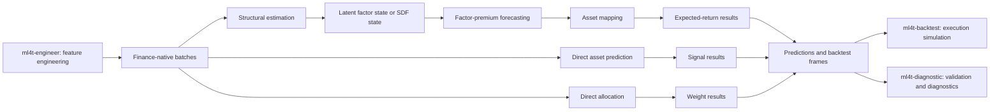

# System Map and Ownership Boundaries

`ml4t-models` owns the **modeling middle** of the ML4T workflow. It accepts already engineered, identity-preserving finance data; estimates model state or predictions; and emits typed results and standardized frames. It does not own raw-data feature construction, simulated execution, or model evaluation.

This is best understood as a sequence of responsibilities, not as a mirror of the Python package tree:

*Contracts enter distinct model domains; typed result surfaces leave `ml4t-models` for execution and evaluation owned elsewhere.*

## Responsibility map

| Stage | Owned here | Boundary and output |
|---|---|---|
| Input contracts | `PersistentPanelBatch`, `CrossSectionBatch`, and `PortfolioSequenceBatch`; dimensional and identity validation | Inputs must already contain the returns, characteristics, context, masks, costs, or sequence features the model needs. Feature definitions and transformations belong to `ml4t-engineer`. |
| Structural estimation | PCA, RP-PCA, IPCA, CAE, and stochastic discount factor estimation | Produces explicit `LatentFactorState` or `StochasticDiscountFactorState`, rather than silently folding economic state into a final score. |
| Forecasting | Separate factor-premium forecasters | Consumes `LatentFactorState` and produces `FactorForecastResult`; it does not re-estimate the structural model. |
| Asset mapping | Mappers such as `BetaLambdaMapper`, plus optional SDF return mappers | Combines structural state with a forecast to produce `AssetForecastResult`. |
| Direct prediction | Asset-level predictors such as `SAEModel` | Produces `AssetSignalResult` without pretending that an intermediate latent representation is a factor model. |
| Allocation | Linear, recurrent, and deep portfolio learners | Consumes `PortfolioSequenceBatch` and produces `PortfolioWeightsResult`; optional postprocessors transform target weights in order. |
| Runtime and persistence | Fit lifecycle, checkpoints, run records, device and dtype resolution, versioned artifacts | Makes training state observable and recoverable, but does not schedule jobs or run a trading system. |
| Integration | Long-frame adapters, results frames, artifact publication, and `DataFeed` handoff builders | Converts model-native results into stable tabular boundaries. `ml4t-backtest` owns order/execution simulation; `ml4t-diagnostic` owns validation and diagnostics. |

See [Model Families](model-families.md) for model-specific assumptions, [Contracts and Public API](../concepts/contracts-and-public-api.md) for the type surface, [Data and Backtest Handoffs](../integrations/data-and-backtest-handoffs.md) for adapters, and [Training Runtime and Artifacts](../operations/training-runtime-and-artifacts.md) for operational details.

## Contracts preserve financial identity

The batches are not interchangeable generic tensors:

- `PersistentPanelBatch` represents a stable entity panel. Returns and characteristics share `(T, N)`, timestamps align to `T`, and non-empty asset identifiers must be unique and align to `N`.
- `CrossSectionBatch` represents dated cross-sections on a date-local slot axis. Its mask records observations, while returns, factor returns, context, timestamps, and identifiers are checked against the characteristic tensor.
- `PortfolioSequenceBatch` represents sequence-to-allocation work with `(B, T, N, F)` features. Optional returns, volatility scaling, prior weights, observation masks, groups, costs, and adjacency masks each have explicit shape rules.

Result contracts continue that identity discipline. Structural states retain dates and assets; factor forecasts retain dates; asset forecasts and signals retain both axes; portfolio weights retain batch, date, and asset axes. Construction fails early on incompatible dimensions, duplicate identifiers, or malformed metadata instead of allowing alignment errors to surface in a backtest.

The tabular ingress adapters are intentionally narrow. They resolve timestamp and entity columns from explicit arguments or schema metadata, sort long-form records, reject duplicate `(timestamp, entity)` rows, and construct either stable panels or masked cross-sections. They adapt already prepared columns; they are not a feature-engineering subsystem.

## Explicit model-domain flows

### Structural estimate, forecast, then map

`LatentFactorForecastPipeline` is the canonical orchestration boundary. During `fit`, it fits the structural model, extracts the training `LatentFactorState`, and fits the forecaster on that state. During `predict`, it extracts state at the requested checkpoint, forecasts factor premia, and passes both objects to the mapper. The returned `LatentFactorPrediction` exposes all three products—state, factor forecast, and asset forecast—so callers can inspect or replace a stage.

This separation is an extension boundary: a new estimator, forecaster, or mapper can participate by satisfying the corresponding protocol in `ml4t.models.api`. The protocols define behavior and lifecycle fields without requiring inheritance from a framework base class.

### Weight-native SDF estimation

The stochastic discount factor domain is structurally distinct from beta-times-lambda forecasting. Its estimator consumes `CrossSectionBatch` and extracts `StochasticDiscountFactorState`, whose primary output is date-by-asset weights with an optional SDF series. Checkpoints may be phase-aware `(phase, epoch)` values. Any return projection is a separate mapping concern rather than an implicit reinterpretation of SDF weights.

### Direct prediction

`AssetPredictionModel` fits and predicts directly from `CrossSectionBatch`, optionally using a validation batch and checkpoint. Its output is `AssetSignalResult`. This path deliberately bypasses factor-premium forecasting and asset mapping; consumers should not treat direct signals as latent-factor state.

### Direct allocation

`PortfolioAllocationPipeline` fits a `PortfolioModel`, then predicts raw weights and applies `PortfolioPostprocessor` hooks sequentially. `PortfolioPrediction` preserves both raw and processed weights. This makes constraints or normalization visible and replaceable rather than hiding them inside execution logic. The output is still a **target allocation**: fills, slippage, market impact, accounting, and orders belong to `ml4t-backtest`.

## Lifecycle, state, and failure boundaries

Public model protocols expose `is_fitted`, `last_fit_record`, and—where checkpoints apply—`available_checkpoints`. Calls that select checkpoints therefore operate on explicit model state rather than an unobservable “latest” network. `FitSummary` carries metrics, convergence, history, notes, and an optional `FitRunRecord`; the record captures package and schema versions, redacted configuration, seed, resolved device and dtype, input dimensions and hash, stopping reason, skipped updates, elapsed time, and an optional error type.

Fit mutations use an atomic lifecycle helper in model implementations: if fitting raises, designated fitted-state attributes are restored to their pre-fit values and the exception propagates. Neural runtime helpers validate `cpu`, `mps`, and CUDA requests, reject unavailable devices and unsupported precision names, and seed accelerator backends with deterministic settings where supported. Torch-heavy models are loaded lazily from the public package and report that the `deep` extra is required when PyTorch is absent.

Persistence is model-owned but format-constrained. Artifacts are ZIP containers containing a JSON manifest and a non-pickle NumPy array payload. Saves stage a temporary file, flush it, and atomically replace the destination. Loads reject unexpected archive members, schema or model-type mismatches, checksum failures, array inventory or shape/dtype mismatches, object arrays, and invalid configuration/state. This boundary protects model reconstruction; it is not an experiment registry or remote artifact service.

## Result surfaces and downstream ownership

Integration surfaces turn native results into long-format `PredictionsFrame`, `SignalsFrame`, or `WeightsFrame`, and weights can also become a wide `ContextFrame`. Non-finite prediction or weight cells are omitted from long frames; target-weight frames add a `selected` flag based on a configurable magnitude threshold. `ResultsFrame` remains usable as Python rows or columns and gains Polars/Parquet conversion through the optional `integration` dependencies.

`BacktestDataFeedInputs` joins one model-output frame with either an in-memory prices frame or a prices path, a resolved feed specification, and optional context. It enforces exactly one price source and can produce kwargs for `ml4t.backtest.DataFeed`. Feed schema resolution and frame conversion live here to stabilize the handoff; calendar interpretation, strategy behavior, order generation, fills, and performance simulation remain downstream.

For file handoff, `write_backtest_frames` writes a complete generation into a staging directory, adds a manifest, and replaces the published directory. If publication fails after moving an existing generation aside, it restores the prior generation. The unit of publication is therefore the frame generation, not a sequence of independently visible Parquet writes.

Diagnostics follow the same ownership rule. This library emits prediction, signal, and weight frames with dates, assets, and metadata. Statistical validation, portfolio diagnostics, and evaluation policy belong to `ml4t-diagnostic`; adding those calculations here would duplicate sibling-library responsibility.

## Extension and safe-change rules

1. **Add modeling behavior behind the domain protocol.** Decide first whether the new method estimates structural state, forecasts premia, maps state, predicts assets directly, or allocates weights. Do not force every model through a latent-factor abstraction.
2. **Preserve axes and labels end to end.** New batch or result fields need construction-time validation and must survive adapters, checkpoints, and frame conversion.
3. **Keep optional dependencies at boundaries.** Core NumPy contracts should import without Torch, Polars, or `ml4t-specs`; heavy functionality should fail only when invoked and explain the required extra.
4. **Do not move evaluation upstream.** A model may report training and validation metrics, but reusable diagnostics and simulated execution remain sibling-library concerns.
5. **Treat artifacts and checkpoints as compatibility surfaces.** Validate type, schema, inventory, device overrides, and checkpoint identity; never deserialize arbitrary pickled objects.

## Focused verification

Changes should be tested at the boundary they affect:

- `tests/test_types.py` checks contract shape and identity invariants.
- `tests/test_pca_pipeline.py` and `tests/test_forecasters.py` exercise the structural → forecast → mapping separation.
- `tests/test_stochastic_discount_factor.py`, `tests/test_sae.py`, and `tests/test_portfolio.py` cover the distinct SDF, direct-prediction, and allocation domains.
- `tests/test_lifecycle.py`, `tests/test_observability.py`, and `tests/test_torch_runtime.py` cover failure rollback, run records, device resolution, and determinism.
- `tests/test_persistence.py` and `tests/test_persistence_validation.py` cover round trips and hostile or malformed artifacts.
- `tests/test_integration_data.py`, `tests/test_integration_surfaces.py`, and `tests/test_integration_backtest.py` cover schema adaptation, frame semantics, atomic publication, and the downstream `DataFeed` boundary.
- `tests/test_financial_correctness.py` guards economic invariants that shape-only tests cannot establish.

The repository-wide quality commands in `AGENTS.md` remain the release gate, but focused tests above are the fastest way to prove a change stayed within its ownership boundary.
