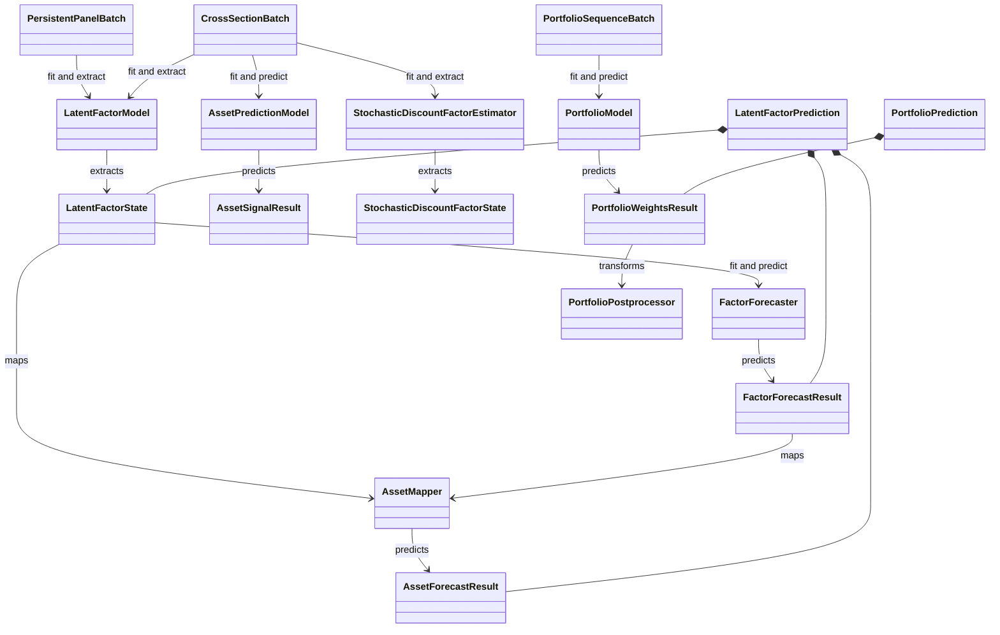

# Finance-Native Contracts and Public API

The supported import boundary is the `ml4t.models` package root. Its `__all__` is required to match the sorted `STABLE_ROOT_EXPORTS` manifest exactly; this covers model and configuration classes, protocols, typed batches/results, pipelines, and data/backtest handoff functions. Optional PyTorch-backed portfolio classes are resolved lazily, so importing the root does not eagerly require PyTorch; accessing one without the `deep` extra raises an installation-oriented `ImportError`. Names from internal bases, loss functions, and helpers are deliberately not part of this contract. See [`_public_api.py`](../../src/ml4t/models/_public_api.py) and the root implementation in [`__init__.py`](../../src/ml4t/models/__init__.py).

The stable submodule surfaces are narrower: [`api.py`](../../src/ml4t/models/api.py) exports the seven behavioral protocols, while [`types.py`](../../src/ml4t/models/types.py) exports finance-native input, state, and result records. Treat these declarations and the root manifest as the compatibility boundary—not `_internal` utilities or an implementation class merely because Python can import it.

## Contract map

*The main public contracts connect finance-shaped inputs to fitted structural state, forecasts, signals, and portfolio weights.*

## Batch contracts and axes

The dataclasses are frozen and slotted records. Numeric fields accepted as array-like values are normalized with `np.asarray(..., dtype=np.float64)` at construction, independently of the estimator's configured compute dtype. Their dimensions are then checked immediately. Optional `timestamps` and `asset_ids` may be omitted, but when present they must align with the corresponding axes.

| Batch | Required core | Optional arrays | Labels and interpretation |
|---|---|---|---|
| `PersistentPanelBatch` | Shape must be inferable from `returns` **(T, N)**, `characteristics` **(T, N, C)**, or both label tuples | `returns`, `characteristics` | `timestamps` has length **T**; `asset_ids` has length **N**. This is the stable-entity panel used by models such as PCA and RP-PCA. A label-only future batch is valid when both tuples establish the shape. |
| `CrossSectionBatch` | `characteristics` **(T, N, C)** | `returns` **(T, N)**, `factor_returns` **(T, N)**, `context_features` **(T, Q)**, `mask` **(T, N)** | `timestamps` has length **T** and `asset_ids` length **N**. The mask marks valid date/slot observations, allowing membership or missingness to vary while retaining an identity-addressable slot axis. |
| `PortfolioSequenceBatch` | `features` **(B, T, N, F)** | `returns` and `vol_scale` **(B, T, N)**; `prev_weights` **(B, N)**; `mask` **(B, T, N)**; `group_ids` **(N,)**; `costs` **(N,)** or **(N, 1)**; `adjacency_mask` **(N, N)** | `timestamps` labels **T**, `asset_ids` labels **N**, and `metadata` is free-form. One-dimensional costs are canonicalized to **(N, 1)**. |

Here **B** is sequence batch size, **T** time, **N** asset or cross-sectional slot, **C** characteristic count, **Q** context width, and **F** per-asset feature width. `n_periods` and `n_assets` expose the resolved **T** and **N**; `PortfolioSequenceBatch` additionally exposes `batch_size`.

The shape checks are strict but intentionally not a complete data-quality policy. For example, batch construction does not require all values to be finite. Estimators apply domain-specific checks later: PCA requires finite information and sufficient rank, while the public factor forecasters accept partially missing histories but reject any factor with no finite observations. This separation permits finance panels with genuine missingness without allowing a model to fit unusable data.

### Masks and auxiliary fields

Masks are shape contracts rather than automatic imputation. `CrossSectionBatch.mask` aligns with its **(T, N)** observations; the portfolio mask aligns with **(B, T, N)**. Likewise, `group_ids`, `costs`, and `adjacency_mask` are asset-axis context for portfolio models, not generic metadata. A portfolio implementation can impose configuration-dependent requirements—for example, group identifiers when group embeddings are enabled or costs when cost context is enabled. The dataclass validates shape, while the estimator decides whether an optional field is required for a particular configuration.

## Identity is part of the value

An `asset_ids` tuple, when supplied, must have exactly one non-empty, unique identifier for each **N** position. The same validation applies to identity-bearing states and results, not only inputs. Error messages report counts and mismatch categories rather than echoing identifiers, which avoids disclosing asset names in common identity failures.

Identity semantics depend on the model family:

- Persistent-panel PCA and RP-PCA retain the fitted universe and can safely accept the same identities in another order. They resolve the requested order against fitted identities and reorder fitted loadings, means, and resulting betas accordingly. A different set—including an unknown or missing identity—is rejected.
- Sequence portfolio models whose learned parameters and context are position-dependent require prediction `asset_ids` to match the fitted tuple in exactly the same order. Their training and validation batches also have to agree on identity and order.
- Unlabeled records remain supported where the model can operate positionally, but omitting labels gives up identity-based reorder protection. Callers should preserve labels across data adapters, model outputs, and backtest handoffs whenever identities are known.

These rules prevent the dangerous case where a numerically valid **N** axis silently assigns learned state or weights to the wrong assets. The PCA reorder and unknown-identity behavior is covered directly in [`test_pca_pipeline.py`](../../tests/test_pca_pipeline.py).

## Protocol lifecycle

The protocols are structural interfaces: an implementation is compatible by providing the declared attributes and methods; callers need not inherit an internal base class.

| Protocol | Training input | Fitted operation and output | Lifecycle/checkpoint surface |
|---|---|---|---|
| `LatentFactorModel` | `fit(PanelBatch)` | `extract(PanelBatch, checkpoint=...) -> LatentFactorState` | `is_fitted`, integer `available_checkpoints`, `last_fit_record` |
| `FactorForecaster` | `fit(LatentFactorState)` | `predict(LatentFactorState) -> FactorForecastResult` | `is_fitted`, `last_fit_record` |
| `AssetMapper` | No fit required by the protocol | combines state and factor forecast into `AssetForecastResult` | Stateless at protocol level |
| `AssetPredictionModel` | `fit(CrossSectionBatch, validation_batch=...)` | `predict(..., checkpoint=...) -> AssetSignalResult` | fitted flag, integer checkpoints, last fit record |
| `StochasticDiscountFactorEstimator` | `fit(CrossSectionBatch)` | `extract(..., checkpoint=...) -> StochasticDiscountFactorState` | phase-aware checkpoints as `(phase, epoch)` tuples; extraction also accepts legacy integer selection |
| `PortfolioModel` | `fit(PortfolioSequenceBatch, validation_batch=...)` | `predict(..., checkpoint=...) -> PortfolioWeightsResult` | fitted flag, integer checkpoints, last fit record |
| `PortfolioPostprocessor` | No fit required by the protocol | transforms weights for a batch into another `PortfolioWeightsResult` | Hook after model prediction |

A normal stateful lifecycle is construct → `fit` → inspect `FitSummary` and `last_fit_record` → `extract` or `predict`. Fitted operations reject premature use. A failed validation must not falsely mark a fresh estimator fitted. Implementations that support checkpoints expose only selectable values through `available_checkpoints`; explicit unavailable values are rejected. Implementations without checkpoints expose an empty tuple and require `checkpoint=None`. When no explicit checkpoint is supplied, checkpointed implementations select their configured default or their latest available checkpoint according to that implementation's public behavior.

`FitSummary` carries convergence, train/validation metrics, best epoch, history, notes, and an optional `FitRunRecord`. Package estimators attach the completed record to the returned summary and expose the same record as `last_fit_record`; failed fit attempts are also recorded before the original error is re-raised. `FitRunRecord` is schema version 1 and captures package/model/config context, seed, resolved device and dtype, input dimensions and a SHA-256 fingerprint, stopping information, skipped updates, elapsed time, and error type. It validates its version, lowercase digest, and non-negative finite counters/timing.

The protocols do **not** declare `save` or `load`, so persistence must not be assumed for every third-party implementation. Concrete package estimators that offer artifact persistence restore fitted parameters, identity state, and the validated last fit record; their own `save`/`load` documentation is the applicable contract. Internal checkpoint selectors, observability decorators, and persistence helpers are implementation mechanisms, not public extension points.

## States, predictions, and weights

All numeric result arrays are normalized to `float64` by the public records and enforce their rank and label alignment:

- `LatentFactorState.asset_betas` is **(T, N, K)**. Optional `factor_returns` must be **(T, K)**; `checkpoint_epoch`, labels, and metadata preserve extraction context.
- `FactorForecastResult.factor_premia` is **(T, K)** and carries time labels.
- `AssetForecastResult.expected_returns`, `AssetSignalResult.signal_values`, and `AssetWeightsResult.weights` are each **(T, N)** with optional time and asset labels.
- `StochasticDiscountFactorState.asset_weights` is **(T, N)**; optional `sdf_values` is exactly **(T,)**, and `checkpoint_epoch` records the selected checkpoint representation.
- `PortfolioWeightsResult.weights` is **(B, T, N)** with optional `checkpoint_step`, timestamps, asset identities, and metadata.

`LatentFactorPrediction` bundles structural state, factor-premium forecast, and mapped asset forecast so their stages remain explicit. `PortfolioPrediction` keeps both `raw_weights` and postprocessed `processed_weights`; callers can audit constraints or transformations rather than losing the model-native output.

Configured estimator dtype and contract dtype serve different purposes. Models may train and store NumPy or PyTorch parameters as configured `float32` or `float64`, and checkpoint tensors preserve that choice. Public batch and result objects normalize their numeric arrays to `float64`, while `FitRunRecord.resolved_dtype` records the estimator's actual configured compute dtype. Tests in [`test_dtype_semantics.py`](../../tests/test_dtype_semantics.py) protect this distinction.

## Validation checklist for implementations

A conforming implementation or adapter should preserve these invariants:

1. Import supported names from `ml4t.models`; do not depend on `_internal` helpers or unexported family bases.
2. Keep every array aligned to its documented axes, including masks, timestamps, asset identities, validation batches, and result labels.
3. Preserve identity through reorder operations, or reject reordered/unknown identities when learned parameters are positional. Never silently reinterpret an **N** axis.
4. Distinguish optional-at-construction fields from fields required by a training operation. In particular, portfolio training needs forward returns even though `PortfolioSequenceBatch.returns` is optional for prediction.
5. Keep `is_fitted` false after an unsuccessful first fit, reject prediction before fit, and report only actually available checkpoints.
6. Return the finance-native result type declared by the protocol, including selected checkpoint and label context where applicable.
7. Keep fit observability redacted and reproducible: use dimensions and input fingerprints rather than embedding raw panel values or asset identifiers in records and errors.

For the placement of these contracts among model families, see [Model Families](../architecture/model-families.md) and [System Map](../architecture/system-map.md). For composition, see [Latent-Factor Forecasting](../workflows/latent-factor-forecasting.md) and [Portfolio Learning](../workflows/portfolio-learning.md). Dataframe conversion and downstream identity preservation are covered by [Data and Backtest Handoffs](../integrations/data-and-backtest-handoffs.md).
