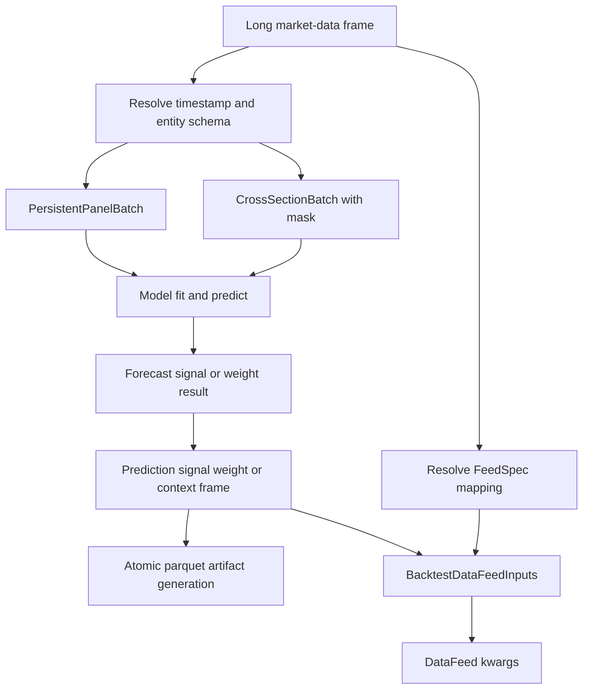

# Data Adapters and Downstream Handoffs

The integration layer is the boundary between tabular market data, the typed NumPy contracts consumed and returned by models, and downstream ML4T tools. Its public entry points are re-exported from `ml4t.models.integration` (and from the package-level model API); the underlying contracts are described in [Contracts and Public API](../concepts/contracts-and-public-api.md). The adapters deliberately do not fit models or run a backtest: they resolve identity, shape arrays, standardize result columns, and prepare `ml4t.backtest.DataFeed` constructor arguments.

*The end-to-end boundary turns long market data into typed batches and model results into durable or in-memory backtest handoffs.*

## Long-frame schema resolution

`resolve_dataset_schema(frame, ...)` accepts a mapping of columns or a tabular object with a `columns` attribute. Resolution has a strict precedence for each identity dimension:

1. an explicit `timestamp_col` or `entity_col` argument;
2. the corresponding value extracted from `schema` or schema-like metadata;
3. the first column found in the default candidate order.

Timestamp candidates are `timestamp`, `datetime`, `date`, then `time`; entity candidates are `asset`, `symbol`, `ticker`, `instrument`, then `security`. A resolved name must actually exist in the frame. Failure to infer a dimension, or an explicit/schema name that is absent, raises `ValueError` before array construction.

Schema input may be a mapping or object. It can expose `metadata` or a nested `schema`, and recognizes timestamp aliases `timestamp_col`, `time_col`, `datetime_col`, and `date_col`, plus entity aliases `entity_col`, `symbol_col`, `ticker_col`, `asset_col`, and `group_col` (with the shorter `timestamp`, `symbol`, `ticker`, and `asset` forms also understood while extracting fields). Nested schema values take precedence over fields on their outer object. `ResolvedDatasetSchema.metadata` contains the normalized extracted identity fields; when a batch is built, these resolved schema values are merged after caller `metadata`, so they win on duplicate keys.

See the implementation in [`integration/data.py`](../../src/ml4t/models/integration/data.py) and the schema-shape coverage in [`test_integration_data.py`](../../tests/test_integration_data.py).

## From long rows to finance-native batches

Both adapters first materialize records and sort them by `(timestamp, str(entity))`. This makes timestamp and asset axes deterministic even when input rows arrive reordered: timestamps are ascending according to their native comparable values, and asset identifiers are lexicographically ordered after string conversion. Every `(timestamp, entity)` pair must be unique; duplicates raise rather than silently selecting or aggregating one row.

### Persistent panels

`persistent_panel_batch_from_long_frame` produces `PersistentPanelBatch`, the stable `(T, N)` panel used by latent-factor workflows such as [Latent-Factor Forecasting](../workflows/latent-factor-forecasting.md):

- `returns`, when `return_col` is supplied, has shape `(T, N)`.
- `characteristics`, when `feature_cols` is non-empty, has shape `(T, N, C)` in the requested feature order.
- `timestamps` and string `asset_ids` label those axes.
- Either value array may be omitted. With both omitted, the labels still establish the panel shape.

Arrays start as `NaN`. Missing timestamp/entity combinations remain `NaN`, as do non-finite numeric values and values such as text or `None` for which NumPy finiteness cannot be established. The adapter therefore preserves panel geometry without pretending missing observations are zero.

### Ragged cross-sections

`cross_section_batch_from_long_frame` produces a global timestamp-by-asset grid but also emits a Boolean `mask` of shape `(T, N)`. A `True` cell means that the entity row existed on that date; an absent or exited entity is `False`. This distinguishes a ragged universe from a present row whose feature or return is missing. `characteristics` has shape `(T, N, C)`, optional `returns` has `(T, N)`, and optional `context_features` has `(T, K)`.

Context columns are date-level data repeated on long rows. For each date and context column, all finite row values must agree within `1e-12`; otherwise the adapter raises `ValueError`. If every value for that date is non-finite, the date-level context value remains `NaN`. Feature and return cells use the same finite-value-to-float rule as persistent panels. This contract is directly useful to [Stochastic Discount Factor](../workflows/stochastic-discount-factor.md) style cross-sectional models.

The typed batch classes perform a second line of validation: array ranks, shared `(T, N)` dimensions, timestamp count, unique non-empty asset IDs, and mask shape must agree. These invariants prevent a superficially valid long-frame conversion from crossing the model boundary with mismatched labels or axes.

## Standard result surfaces

A `ResultsFrame` is a lightweight immutable table: ordered `columns`, tuple-valued `rows`, and free-form `metadata`. `to_dicts()` and `to_columnar()` need no dataframe dependency. `to_polars()` imports Polars only when called, and `write_parquet()` delegates to Polars after creating the parent directory. If Polars is unavailable, conversion and parquet export raise an `ImportError` that points to `pip install 'ml4t-models[integration]'`; constructing and inspecting frames remains available without Polars.

All result converters iterate in model-array order and discard non-finite long-form values. If timestamps or asset IDs are absent from a result, generated labels are integer periods and `asset_0`, `asset_1`, and so on. Caller-provided `constants` are appended as columns, preserving insertion order and repeating their values on every emitted row.

| Surface | Input and column contract | Important behavior |
|---|---|---|
| `PredictionsFrame` | `AssetForecastResult` or `AssetSignalResult` becomes `timestamp`, `asset`, `prediction_value`, then constants | Finite expected returns or signal values only; metadata sets `frame_type` to `prediction` and carries result metadata. |
| `SignalsFrame` | Weight result becomes `timestamp`, `asset`, optional `batch_id`, `signal_value`, `selected`, then constants | `selected` is `abs(value) > selected_threshold`, default `1e-9`; finite values only. |
| `WeightsFrame` | Weight result becomes `timestamp`, `asset`, optional `batch_id`, `weight`, `selected`, then constants | Same selection and filtering rule; intended as the long target-weight handoff. |
| `ContextFrame` | `timestamp`, one wide column per asset named with a prefix (default `w_`), then constants | Emits every date and converts non-finite weights to `0.0`; portfolio results must have exactly one batch. |

`AssetWeightsResult` is two-dimensional `(T, N)` and never needs `batch_id`. `PortfolioWeightsResult` is `(B, T, N)`; its long signal/weight frame includes `batch_id` only when `B > 1`, preserving the identity of otherwise duplicate timestamp/asset rows. A portfolio checkpoint step is copied into signal, weight, and context metadata when present. Wide context cannot represent several portfolios at the same timestamp and therefore rejects `B != 1` rather than losing batch identity. Weight surfaces connect directly to [Portfolio Learning](../workflows/portfolio-learning.md).

## Atomic parquet generations

`write_backtest_frames(artifact_dir, predictions=..., weights=...)` publishes a complete directory generation, not independent file updates:

1. It rejects an existing target that is not a directory and creates a sibling hidden staging directory.
2. Each requested frame is written there as `predictions.parquet` or `weights.parquet` with `zstd` compression by default. A writer that returns without creating its file is treated as failure.
3. It writes a compact, sorted `manifest.json` containing `format_version: 1` and an alphabetically sorted `files` list of the parquet files in that generation.
4. Publication moves an existing output directory to a hidden previous-generation directory, then uses `os.replace` to move the staging directory into the public path. After success, the previous directory is removed.

Because a generation contains only requested frames, a later predictions-only publication removes a stale `weights.parquet` automatically. A write or manifest failure occurs entirely in staging: staging is deleted and the public generation is untouched. If publication fails after the previous generation was moved aside, `_publish_generation` restores that directory to the public path; the outer error handler then cleans staging and re-raises. Thus readers see either the prior complete generation or the new complete generation, subject to the filesystem's rename semantics, rather than a deliberately mixed set of files.

The generation and failure behavior is exercised in [`test_integration_surfaces.py`](../../tests/test_integration_surfaces.py), including omitted-output cleanup, second-write failure, publish rollback, and a writer that produces no file.

## FeedSpec resolution

`resolve_feed_spec_mapping` creates the mapping passed as `feed_spec` to `ml4t.backtest.DataFeed`. When `ml4t.specs.market_data.FeedSpec` is importable, it delegates initial coercion to `FeedSpec.from_any()` and serializes the result. Without that optional class, a compatibility path reads either a flat schema or nested `schema` and `semantics` sections. The fallback normalizes `time_col` or `datetime_col` to `timestamp_col`, the entity aliases to `entity_col`, and `frequency` to `data_frequency`; it also preserves time-contract fields such as `bar_grid_anchor`, `bar_label`, and `partial_bar_policy`.

Resolution then follows these rules:

- With an inspectable in-memory frame, timestamp and entity names go through `resolve_dataset_schema`, so explicit arguments override schema metadata and metadata overrides frame candidates.
- Without an inspectable frame—for example, a parquet path—explicit names override the coerced schema, then defaults fill `timestamp_col="timestamp"` and `entity_col="asset"`.
- Non-`None` column and time-semantic arguments override schema values: price/OHLCV, quote and size columns, timezone, frequency, bar type, timestamp semantics, and session start time.
- `price_col` defaults to an explicit `close_col`, then follows a nonstandard schema `close_col` when the inherited price is merely `close`; otherwise it defaults to `close`. Open, high, low, close, and volume defaults are filled afterward.

Calendar uses a sentinel because omission and explicit disabling differ. Leaving `calendar` unset preserves schema behavior. Passing a non-empty calendar name replaces it. Passing `calendar=None` explicitly records `calendar: null` **and** `time_contract_version: 2`, so downstream `FeedSpec` interprets this as calendar-free rather than legacy null inheritance. Blank strings and non-string non-null values are rejected without mutating the input schema. The same override is threaded through forecast, signal, and weight convenience handoffs; tests also verify that versioned calendar presence and bar-grid semantics survive serialization.

## Building the DataFeed handoff

`BacktestDataFeedInputs` owns five pieces: the resolved `feed_spec`, exactly one price source, an optional long signal-like frame, an optional wide context frame, and integration metadata. Price source exclusivity is enforced both by the builder and the dataclass: provide one of `prices_frame` or `prices_path`, never neither or both.

`to_datafeed_kwargs()` translates the payload to the names expected by `DataFeed`:

| Payload field | Emitted kwarg | Conversion |
|---|---|---|
| `feed_spec` | `feed_spec` | Shallow-copied mapping |
| `prices_frame` | `prices_df` | Passed through unchanged |
| `prices_path` | `prices_path` | Converted to `str` |
| `signals` | `signals_df` | `ResultsFrame.to_polars()` |
| `context` | `context_df` | `ResultsFrame.to_polars()` |

Only present optional fields are emitted. Consequently, Polars is needed at handoff time only when a model result frame must become a dataframe; a price-only path handoff does not convert a result surface.

Use the convenience constructors according to result semantics:

- `backtest_inputs_from_asset_forecast` and `backtest_inputs_from_asset_signal` create a `PredictionsFrame` in `signals_df`.
- `backtest_inputs_from_weights(..., as_context=False)` creates a long `WeightsFrame` in `signals_df`.
- `backtest_inputs_from_weights(..., as_context=True)` suppresses `signals_df` and creates a wide `ContextFrame` in `context_df`; `context_prefix` controls its asset-column prefix.
- `backtest_datafeed_inputs` accepts already-standardized surfaces directly and records their `frame_type` as `signal_frame_type` metadata unless the caller supplied that key.

These helpers prepare constructor kwargs; they do not import or instantiate `ml4t.backtest.DataFeed`. This keeps the model package's integration boundary inspectable and lets consumers decide when to load the backtest runtime. Feed mapping, source exclusivity, convenience modes, calendar semantics, and argument names are covered in [`test_integration_backtest.py`](../../tests/test_integration_backtest.py).

## Safe extension points

- Add a new long-frame adapter only if it returns a typed batch and preserves identity, deterministic ordering, missingness, and duplicate rejection. Do not infer zeros from absence.
- Add downstream columns through `constants` when they are truly row-constant. Changing the standard names (`prediction_value`, `signal_value`, `weight`, `selected`) changes the diagnostic/backtest contract.
- Keep optional dataframe behavior behind `to_polars()` or parquet methods so core model use remains dependency-light.
- Treat the artifact directory and manifest as one generation. Writing extra files into that directory out of band is unsafe because the next publication intentionally replaces the whole directory.
- When extending FeedSpec fields, update both the installed-`FeedSpec` route and the fallback route, and preserve the difference between an omitted value and an explicit null where the time contract assigns meaning to presence.

For where this boundary sits among model families and external libraries, see the [System Map](../architecture/system-map.md).
