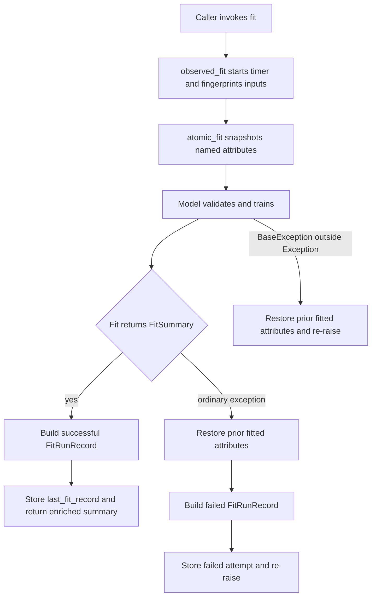
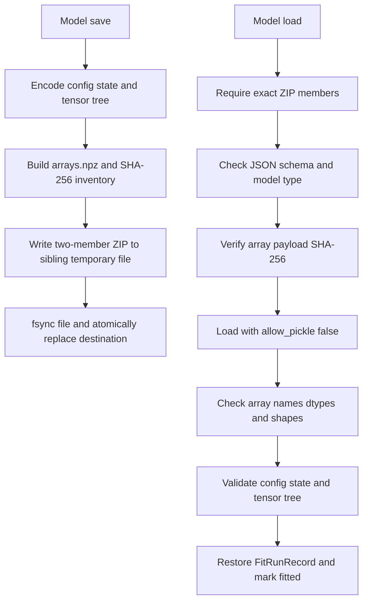

# Training Runtime, Observability, and Artifacts

This page describes the cross-cutting contracts around model training rather than any one model's mathematics. The model families share validated configuration, fit-attempt telemetry, failure rollback, checkpoint conventions, and a safe ZIP-based persistence layer. Neural models additionally resolve an optional PyTorch runtime only when their execution path needs it.

For where these pieces sit in the package, see the [System Map](../architecture/system-map.md). For end-to-end use, see [Latent-Factor Forecasting](../workflows/latent-factor-forecasting.md), [Portfolio Learning](../workflows/portfolio-learning.md), and [Stochastic Discount Factor](../workflows/stochastic-discount-factor.md).

## Shared configuration and runtime resolution

`BaseModelConfig` is the immutable, slotted base for public model configurations. It provides:

- `seed: int = 42`; booleans are rejected even though `bool` is an `int` subclass.
- `device: str = "cpu"`, restricted to `cpu`, `mps`, `cuda`, or `cuda:<index>`.
- `dtype: str = "float64"`, restricted to `float32` and `float64`.

Specialized frozen dataclasses add model identity as a non-constructor `ClassVar`, optimization settings, and checkpoint schedules. Validation happens in `__post_init__`, before a model can run: counts must be integral and in range, real-valued controls must be finite, probabilities and learning rates have explicit bounds, checkpoint entries cannot be duplicated or exceed the training horizon, and architecture-specific constraints such as attention divisibility are enforced. This makes configuration the first operational failure boundary, not a collection of unchecked training hints.

### Optional PyTorch behavior

PyTorch is not a core dependency. The `deep` extra declares `torch>=2.13.0` only for `python_version < '3.15'`; therefore do not infer that Torch is available merely because the core package imports or because a Python interpreter is supported. In particular, the repository qualifies the Python 3.15 core surface without Torch. Install and verify a compatible Torch build only on a supported interpreter when using neural models.

The package avoids pulling Torch into ordinary core workflows in two ways:

1. Neural implementations such as SAE, CAE, and SDF call `import_torch()` inside runtime methods. A missing installation becomes a focused `ModuleNotFoundError` explaining that the model requires PyTorch.
2. Portfolio neural model classes are exposed through module `__getattr__`; requesting one imports its implementation on demand and translates a missing `torch` module into an `ImportError` that points to `ml4t-models[deep]`.

After import, `resolve_device()` normalizes whitespace and case and applies hardware checks. CPU always resolves directly. CUDA must report available, and an explicit CUDA index must be lower than `torch.cuda.device_count()`. MPS must have an available backend. Unknown device names fail rather than silently falling back to CPU. `resolve_dtype()` maps only the two public precision names to `torch.float32` or `torch.float64`.

## Reproducibility

Neural fits call `seed_torch(torch, seed, device)` before model initialization or per ensemble member. All devices receive `torch.manual_seed(seed)`. CUDA additionally gets `CUBLAS_WORKSPACE_CONFIG=:4096:8` if the operator has not set it, deterministic algorithms when the installed Torch exposes that API, disabled cuDNN benchmarking, deterministic cuDNN behavior, and `torch.cuda.manual_seed_all(seed)`. MPS receives `torch.mps.manual_seed(seed)` when available.

These controls improve repeatability for the selected backend; they are not a promise of bitwise equality across Torch versions, hardware types, or unsupported operations. Training code uses Torch generators or Torch sampling for shuffles, and focused lifecycle tests verify that neural fits do not mutate NumPy's process-global RNG state.

## Atomic fit and fit-run observability

Models expose the latest attempt through `FitObservable.last_fit_record`. `@observed_fit` measures elapsed time and builds a schema-versioned `FitRunRecord` for both successful and ordinarily failed attempts. A successful record is also inserted into the returned immutable `FitSummary`. The record contains package/model/config identity, seed, normalized configured device and dtype, array dimensions, a SHA-256 fingerprint of fit inputs, stopping reason, skipped update count, duration, and an optional exception class name.

The observability wrapper stores no raw arrays, timestamps, asset identifiers, or metadata values. It skips each dataclass's `metadata` field and emits only dimensions and a digest; tuple and scalar input values may influence the digest but are not retained in plaintext. The `resolved_device` field is derived from normalized configuration by the decorator—it is not itself a hardware probe. On successful neural paths, actual device resolution has already validated the request.

`@atomic_fit(*attribute_names)` snapshots the listed model attributes and restores them if the wrapped fit raises any `BaseException`. It is deliberately shallow: model implementations must list every fitted-state owner and must replace, rather than mutate in place, snapshot containers while fitting. Tests inject checkpoint-capture failures after a successful fit and verify that checkpoints, dimensions, history, fitted status, and predictions all remain those of the prior fit.

Decorator order is essential:

```python
@observed_fit
@atomic_fit("_checkpoint_states", "_history", "_is_fitted")
def fit(...):
    ...
```

`atomic_fit` is the inner wrapper. It first restores the old predictive state, then re-raises; the outer `observed_fit` catches ordinary `Exception`, writes a new failed `FitRunRecord`, and re-raises. Consequently, a failed refit leaves the model usable with its prior fitted parameters **while `last_fit_record` describes the failed attempt**. This is intentional: rollback protects serving state, while the retained failure record protects operational visibility. Because observability catches `Exception` while rollback catches `BaseException`, interrupts such as `KeyboardInterrupt` still roll state back but are not converted into a failed record.



*Fit rollback preserves predictive state, while the outer observer retains ordinary failed attempts.*

Stopping reasons are normalized to values such as `converged`, `iteration_limit`, `early_stopping`, `completed`, and `failed`. The observer derives early stopping from the relevant model's history/checkpoint progress and fit arguments; `skipped_updates` comes from `FitSummary.train_metrics`. `FitRunRecord` validates schema version 1, non-empty identity, a lowercase 64-character digest, non-negative skipped updates, and finite non-negative elapsed time.

## Checkpoint semantics

Checkpoint controls live in model configuration and are part of the persisted state:

- Epoch-based SAE/CAE schedules accept an interval or explicit epochs. The shared resolver de-duplicates and sorts the grid and includes the final epoch. An explicit checkpoint passed to inference must exist.
- With no explicit inference checkpoint, the shared selector uses a configured default if present, otherwise the latest available checkpoint. A configured default that was not actually produced fails at selection rather than silently choosing another state.
- CAE validation adds checkpoint `0` for the best validation state of each ensemble member and makes it the fit-time default. Without validation it uses the configured/default schedule behavior.
- Neural portfolio training checkpoints configured steps, records the best validation-Sharpe state even if it falls on an evaluation-only step, and may stop before the nominal final step. Its available inventory is therefore the authority.
- SDF checkpoints are phase-qualified pairs such as `("conditional", epoch)`; configuration validates phase-specific horizons. Do not treat these as interchangeable with plain epoch integers.

Always inspect `available_checkpoints` after fit or load. `FitSummary.best_epoch` reports training's selected/best result, while an inference method's omitted `checkpoint` follows that model's own default-selection contract.

## Artifact format and save protocol

`save_artifact()` writes a ZIP containing **exactly** two members:

| Member | Contents |
| --- | --- |
| `manifest.json` | Schema version, fully qualified model type, encoded config and model state, SHA-256 of the array payload, and each array's dtype and shape |
| `arrays.npz` | Compressed contiguous NumPy arrays containing numerical fitted state |

Metadata encoding supports JSON primitives, lists, string-keyed mappings, and tagged tuples. It rejects non-finite floats, unsupported objects, and non-string metadata keys. Arrays must have non-empty string names and cannot use object dtype.

Torch state dictionaries are not pickled. `pack_tensor_tree()` recursively represents dict/list/tuple containers in JSON and converts every tensor-like leaf through `detach().cpu().numpy()` into a named array. `unpack_tensor_tree()` copies arrays into `torch.from_numpy()`, rejects malformed nodes, missing or reused arrays, duplicate or unsupported keys, unknown container kinds, and any stored array not referenced by the tree. Supported dictionary keys are strings, integers, and tuples.

Saving is replacement-atomic at the file level: the complete archive is written to a uniquely named temporary file in the destination directory, the file is flushed with `fsync`, and `os.replace()` installs it. The parent directory is then synced on platforms that support directory file descriptors; Windows skips that last operation. The temporary file is cleaned in `finally`. If replacement fails, an existing destination remains unchanged.

## Load validation and restoration

Loading treats the artifact as untrusted structured data and validates layers before returning a model:

1. Open as ZIP and require the exact two-member inventory—extra members are rejected too.
2. Decode `manifest.json` as UTF-8 JSON and require artifact schema version `1`.
3. Require the caller's expected `model_type` exactly; loading a PCA artifact through an RP-PCA loader fails.
4. Verify the SHA-256 of the raw `arrays.npz` payload.
5. Load NumPy data with `allow_pickle=False`, reject object arrays, and compare names, dtypes, and shapes with the manifest inventory.
6. Decode config and state as mappings, reconstruct the concrete validated config, optionally overriding only `device`, then apply each model's required-array names and dimensional checks.
7. Rebuild tensor trees where applicable, restore and validate `fit_run_record`, and only then mark the reconstructed model fitted.

The checksum detects accidental or unsophisticated payload alteration, but it is not a signature or authenticity guarantee because an attacker able to rewrite the archive can also rewrite the manifest hash. Artifact provenance still belongs in the surrounding deployment controls.



*Save builds a durable two-member archive; load crosses each validation boundary before exposing fitted state.*

A fitted model cannot be saved without a run record. `state_with_fit_record()` serializes the record into model state, while `restore_fit_record()` rejects a missing, non-mapping, or schema-invalid record. This guarantees that successful round trips preserve both predictions and the fit-attempt provenance associated with the saved state.

## Operational verification

The focused suites are a practical change checklist:

- `tests/test_configs.py`: shared and family-specific validation, immutable model identity, and checkpoint bounds.
- `tests/test_torch_runtime.py`: device availability/index handling, dtype mapping, and backend-specific seeding controls.
- `tests/test_lifecycle.py`: failed-refit rollback, prediction preservation, and NumPy global RNG isolation.
- `tests/test_observability.py`: stable/redacted fingerprints, failed records, stopping reasons, and skipped updates.
- `tests/test_persistence.py`: fresh-process and model-family round trips plus wrong-model rejection.
- `tests/test_persistence_validation.py`: malformed ZIP/JSON/NPZ inputs, checksum and inventory tampering, no-object arrays, tensor-tree validation, atomic replacement, and fit-record restoration.

See [Change Validation](../testing/change-validation.md) before modifying any of these contracts. Changes to a model's fitted attributes must update its `@atomic_fit` list and persistence state together; changes to checkpoint key shape must update selection, tensor-tree restoration, and artifact validation together.
