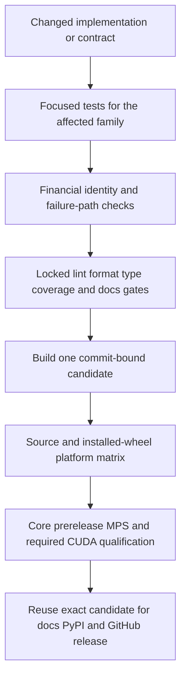

# Change Validation and Test Strategy

Validation in `ml4t-models` is layered. During implementation, run the narrowest tests that prove the changed behavior; before declaring the final revision qualified, run every applicable repository gate against the final commit. A green shape assertion is not enough for finance-facing changes: tests are expected to preserve temporal and asset identity, model-family definitions, portfolio and SDF economics, transactional failure behavior, and installed-package boundaries.

For the contracts themselves, see [Contracts and Public API](../concepts/contracts-and-public-api.md). Data and backtest boundary details are in [Data and Backtest Handoffs](../integrations/data-and-backtest-handoffs.md), while neural execution and artifacts are covered by [Training Runtime and Artifacts](../operations/training-runtime-and-artifacts.md).

## Validation layers



*The validation path progresses from fast, change-local evidence to qualification of one immutable release candidate.*

### Focused iteration

Use file-level or test-name selection while changing behavior, for example:

```bash
uv run pytest tests/test_types.py -q
uv run pytest tests/test_financial_correctness.py -q
uv run pytest tests/test_persistence.py tests/test_persistence_validation.py -q
uv run pytest tests/test_integration_data.py tests/test_integration_backtest.py -q
uv run pytest tests/test_lifecycle.py -q
```

A focused check is evidence for the affected contract, not final qualification. Add a regression that fails on the relevant base revision and passes with the fix. Numerical changes should pin the intended definition, sign, annualization, identity ordering, mask behavior, or constraint—not merely the result's dimensions.

Pytest declares `slow` and `optional_dependency` markers and enforces marker spelling with `--strict-markers`. The repository's default `addopts` does **not** filter either marker, so a complete `pytest tests/` run includes all discovered tests. Marker selection such as `-m "not slow"` is useful only for explicitly scoped iteration and must not be reported as the complete suite. Heavy neural behavior belongs behind the `deep` extra; Polars and `ml4t-specs` behavior belongs behind `integration`.

## Complete final gates

CI uses Python 3.12, `UV_NO_SOURCES=1`, uv `0.10.9`, and locked dependency synchronization. Reproduce the main local gates with a lock-respecting environment:

```bash
UV_NO_SOURCES=1 uv sync --locked --dev --extra docs --python 3.12
uv run ruff check src/ tests/ examples/ scripts/
uv run ruff format --check src/ tests/ examples/ scripts/
uv run ty check
uv run pytest tests/ -q --cov-report=json:coverage.json
uv run python scripts/ci/check_coverage.py coverage.json
uv run mkdocs build --strict
uv build
```

These commands correspond to the repository's documented lint, formatting, source type-check, pytest/coverage, strict documentation, and package-build gates. CI additionally type-checks the named `scripts/ci` programs, runs `twine check` on built distributions, records and verifies candidate identity, and verifies the generated documentation's release metadata. Do not substitute an unlocked or `--frozen` environment for the workflow's `uv sync --locked` contract.

Coverage is a semantic gate rather than a single aggregate percentage. `scripts/ci/check_coverage.py` requires at least **90% line** and **85% branch** coverage overall, and **95% line** and **90% branch** coverage for critical contract, persistence, integration, portfolio-runtime, and SDF modules. A critical module missing from `coverage.json` is itself a failure. Tests in `tests/test_coverage_gate.py` protect threshold calculation, independent line/branch failures, per-module enforcement, and missing-module rejection.

## What must be proved

### Contracts, identity, and core imports

- `tests/test_public_api.py` compares root exports to the authoritative stable manifest, requires explicit supported submodule exports, and prevents internal bases and loss helpers from leaking into supported APIs. Update it whenever a public name is intentionally added, removed, or renamed.
- `tests/test_types.py` validates alignment among timestamps, assets, masks, characteristics, returns, context, factors, costs, and result arrays. Contract changes should test invalid alignment and invalid asset identifiers as well as the valid path.
- Identity-sensitive model tests must cover reordered assets, unknown assets, entry/exit, and ragged sections where applicable. `tests/test_pca_pipeline.py` verifies fitted asset state is reordered by identity; `tests/test_integration_data.py` verifies identity survives long-frame entry, exit, and row reorder.
- `tests/test_core_install.py` starts a fresh subprocess that actively blocks every `torch` import, then fits and predicts with the linear portfolio model. It also verifies that importing a neural model fails with the `install ml4t-models[deep]` guidance. This is the required regression target for changes to lazy exports, root imports, optional dependencies, or packaging.

### Financial correctness

`tests/test_financial_correctness.py` is the cross-family invariant suite. It pins RP-PCA's Lettau–Pelger signal matrix, CAE managed-portfolio OLS behavior, IPCA's deterministic identification without changing fitted predictions, and the paper sign `1 - sum(R * w)` for the stochastic discount factor. It also verifies that masked non-finite values do not contaminate SDF losses or portfolio returns.

Portfolio changes should prove economic and optimization invariants together: transaction costs begin from supplied initial holdings, training is invariant to forward chunk size, best checkpoints contain the exact state that was evaluated, turnover and exposure constraints hold jointly, score order is preserved where promised, and infeasible constraints fail. Neural training rejects non-finite objectives, gradients, gradient norms, parameters, and validation metrics rather than checkpointing corrupted state. Attention tests cover long lags, isolated nodes, and masked neighbors.

Model-specific suites add family assumptions:

- PCA and RP-PCA: `tests/test_pca_pipeline.py`, `tests/test_rp_pca.py`, and `tests/test_estimator_validation.py`.
- IPCA: `tests/test_ipca.py` and `tests/test_ipca_normalization.py`, including orthonormal loadings, diagonal descending factor covariance, deterministic signs, and prediction invariance under normalization.
- CAE: `tests/test_cae.py` and managed-portfolio checks in `tests/test_financial_correctness.py`, including checkpoint selection and the two-step forecast path.
- Factor forecasters: `tests/test_forecasters.py`, including recursive paths and pre-fit rejection.
- SAE/direct prediction: `tests/test_sae.py`, including checkpointed signals, classification probabilities, and minimum training-data behavior.
- SDF estimators and heads: `tests/test_stochastic_discount_factor.py` and `tests/test_sdf_validation.py`, including phase-local burn-in, validation-best checkpoints, weight-native output, and incompatible checkpoint/payload rejection.
- Linear, LSTM, and deep portfolios: `tests/test_portfolio.py`, with runtime invariants in `tests/test_financial_correctness.py` and device/precision behavior in `tests/test_torch_runtime.py` and `tests/test_dtype_semantics.py`.

### Lifecycle, rollback, and observability

A failed refit must not partially replace a usable model. `tests/test_lifecycle.py` injects checkpoint-capture failures into CAE, SAE, SDF, and the SDF beta head, then verifies that prior checkpoints, metadata, fitted status, and predictions are restored. It also verifies neural fits do not mutate NumPy's global random state. Any new trainable family should receive equivalent success, failed-refit rollback, and RNG-isolation coverage.

`tests/test_observability.py` treats `FitRunRecord` as part of the artifact and operational contract: successful records are stable and omit raw inputs, failed attempts retain redacted records, early stopping and skipped updates are observable, and fitted objects without a run record cannot be persisted.

### Artifacts and fresh processes

Persistence tests compare behavior, not just archive creation. `tests/test_persistence.py` round-trips PCA, RP-PCA, IPCA, forecasters, linear and neural portfolios, CAE, SAE, SDF, and SDF mappers while requiring predictions and fit records to survive. The PCA artifact is additionally loaded and used in a fresh Python subprocess, which catches dependence on in-memory registration or process state.

`tests/test_persistence_validation.py` exercises the hostile path: malformed archives and member inventories, manifest/type/identity mismatches, payload tampering, unsafe metadata or object arrays, invalid tensor trees, and missing run records must be rejected. Its atomic-save regression injects a failed replacement and requires the prior artifact to remain intact. Persistence changes therefore need compatibility and rollback tests, not only same-process round trips.

### Integrations and publication transactions

Integration tests protect identities and transaction boundaries:

- `tests/test_integration_data.py` covers schema resolution, duplicate detection, long-frame conversion, masks and context, metadata-only panels, non-finite data, and identity across changing cross-sections.
- `tests/test_integration_backtest.py` covers `FeedSpec` object and fallback mappings, one-and-only-one price source, prediction/signal/weight handoffs, calendar overrides (including explicit disable), bar-grid preservation without `ml4t-specs`, and observation scale across irregular timestamp gaps.
- `tests/test_integration_surfaces.py` covers financial frame names and columns, Polars/Parquet conversion, finite-value filtering, standard artifact names, stale-output removal, and directory publication. Injected write or publish failures must preserve the prior generation; a failed first publication must clean staging.

See [Data and Backtest Handoffs](../integrations/data-and-backtest-handoffs.md) before changing serialization or calendar semantics.

## Change-to-tests routing

| Change area | Focused tests to run or extend | Required risk evidence |
|---|---|---|
| Root public API or supported submodule exports | `tests/test_public_api.py`, `tests/test_core_install.py` | Stable manifest, no internal leakage, lazy optional import behavior |
| Batch/result contracts and identity | `tests/test_types.py`, `tests/test_integration_data.py`, `tests/test_pca_pipeline.py` | Timestamp/asset/mask alignment, reorder and ragged behavior, invalid identities |
| PCA and RP-PCA | `tests/test_pca_pipeline.py`, `tests/test_rp_pca.py`, `tests/test_estimator_validation.py`, relevant financial tests | Structural recovery, paper moment definition, identity reorder, unavailable factor counts |
| IPCA | `tests/test_ipca.py`, `tests/test_ipca_normalization.py`, relevant financial tests | Identification, normalization invariance, ragged sections, future-return independence |
| CAE | `tests/test_cae.py`, `tests/test_latent_factor_utils.py`, `tests/test_lifecycle.py`, relevant financial tests | Managed-portfolio OLS, checkpoint semantics, rollback, two-step path |
| Factor forecasting and latent-factor pipelines | `tests/test_forecasters.py`, `tests/test_pca_pipeline.py`, `tests/test_estimator_validation.py` | Recursive forecast definition, missing history, explicit estimate/forecast/map stages |
| SAE/direct asset prediction | `tests/test_sae.py`, `tests/test_lifecycle.py`, `tests/test_dtype_semantics.py` | Task semantics, checkpointed predictions, rollback, dtype |
| SDF model, mapper, or beta head | `tests/test_stochastic_discount_factor.py`, `tests/test_sdf_validation.py`, `tests/test_lifecycle.py`, relevant financial tests | Paper sign, masks, weight-native output, phase/checkpoint semantics, rollback |
| Linear portfolio family | `tests/test_portfolio.py`, `tests/test_core_install.py`, relevant financial tests | Core install without Torch, exposures, turnover, costs, identity |
| LSTM or deep portfolio family | `tests/test_portfolio.py`, `tests/test_neural_components.py`, `tests/test_torch_runtime.py`, relevant financial tests | Context/state requirements, topology, attention masks, finite training, constraints |
| Shared neural runtime, device, precision, or seeding | `tests/test_torch_runtime.py`, `tests/test_dtype_semantics.py`, `tests/test_lifecycle.py`, `tests/test_financial_correctness.py` | Device rejection, configured dtype, RNG isolation, exact evaluated checkpoint, non-finite failure |
| Save/load format or artifact metadata | `tests/test_persistence.py`, `tests/test_persistence_validation.py`, `tests/test_observability.py` | Fresh-process compatibility, prediction/run-record preservation, tamper rejection, atomic rollback |
| Data, Polars, diagnostics, or backtest integration | `tests/test_integration_data.py`, `tests/test_integration_surfaces.py`, `tests/test_integration_backtest.py` | Optional-dependency errors, schema/identity/calendar preservation, transactional publication |
| Documentation or examples | `tests/test_examples.py`, `uv run mkdocs build --strict`, `scripts/ci/verify_docs_deployment.py` path | Executable examples and quickstart, strict links/API rendering, revision identity |
| Packaging, dependency metadata, or release automation | `tests/test_core_install.py`, `tests/test_release_candidate.py`, `tests/test_release_workflow.py`, `tests/test_repo_hygiene.py` | Wheel/sdist contents and metadata, locked/no-sources install, candidate identity, platform and release reuse |

After focused tests pass, run the complete gates above. Changes spanning multiple rows require the union of their focused suites.

## Candidate and release readiness

CI does not independently build a package on every platform. Lint, type, coverage, and docs must pass first; then `build-candidate` creates wheel and sdist, binds them to commit and Git tree in `candidate.json`, checks metadata, and uploads the candidate. The stable matrix on Ubuntu, macOS, and Windows for Python 3.12, 3.13, and 3.14 verifies that identity, runs source tests and type checking, compares rebuilt wheel contents, and tests the installed candidate. Ubuntu/Python 3.12 also requires a byte-identical canonical wheel.

Additional qualification audits current and minimum dependencies, tests the core installed candidate on Python 3.15 prereleases without Torch, and runs an advisory MPS smoke test. CUDA qualification on the designated RTX 3090 is mandatory for release qualification and pushes to `main`; it exercises public neural workflows and repeated canonical/scaling performance profiles, checking timing stability and deterministic replay. `tests/test_release_candidate.py` ensures those profiles cover PCA, RP-PCA, IPCA, CAE, SDF, SAE, and all three portfolio families.

The release workflow accepts an explicit version and current `main` commit, invokes the complete CI workflow with that version, and selects the resulting commit/tree/version/SHA256-bound candidate. It does **not** rebuild after qualification. The same artifacts gate revision-identified documentation, PyPI publication, the commit-bound GitHub release, published-wheel README smoke testing, artifact digest verification, and deployed-doc identity verification. A post-publication failure opens a recovery path rather than pretending the immutable published version can be rebuilt or reused.

`tests/test_release_workflow.py`, `tests/test_release_candidate.py`, and `tests/test_repo_hygiene.py` are therefore functional release controls, not incidental YAML tests. Run them for workflow, packaging, dependency, action pin, platform matrix, documentation deployment, or repository-layout changes.

## Review checklist

1. Identify every affected row in the routing table and add a regression at the public workflow or invariant boundary.
2. Test invalid, masked, missing, reordered, and rollback cases—not only nominal output shape.
3. For numerical changes, state which financial definition and sign convention is intentional.
4. For optional dependencies, prove the core import and a non-neural workflow still work in a fresh process without Torch; verify actionable errors for unavailable extras.
5. For stateful changes, prove failed refits and failed writes preserve the last good state.
6. For persistence, compare recovered predictions and run records and include fresh-process loading where registration/import behavior could matter.
7. Run focused checks while iterating, then all applicable locked-environment gates against the unchanged final revision.
8. For a release, qualify and promote the exact commit-bound candidate; never rebuild between qualification and publication.
