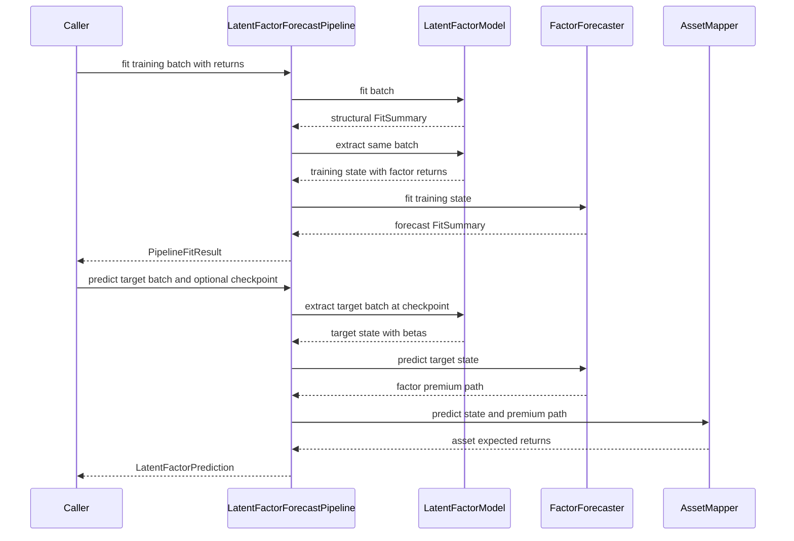

# Latent-Factor Forecasting Workflow

`LatentFactorForecastPipeline` is the two-step forecasting composition for models that first extract a latent factor structure and then forecast returns. It joins three protocol-level components:

1. a `LatentFactorModel` that produces time-varying or static asset betas and, when returns are present, realized factor returns;
2. a `FactorForecaster` that learns a premium process from the training factor-return history; and
3. an `AssetMapper` that converts forecast factor premia back to asset-level expected returns.

The standard mapper is `BetaLambdaMapper`, so the final operation is

\[
\widehat r_{t,n} = \sum_{k=1}^{K} \beta_{t,n,k}\widehat\lambda_{t,k}.
\]

This workflow deliberately keeps structural estimation, factor-premium forecasting, and mapping replaceable. The relevant interfaces and typed result contracts are described in [Contracts and Public API](../concepts/contracts-and-public-api.md); the broader family placement is in [Model Families](../architecture/model-families.md).

## End-to-end sequence

*The pipeline fits the forecaster on factor returns extracted from the training panel, then reuses that fitted premium process with target-batch betas at prediction time.*

## Fit phase: structure first, forecaster second

`LatentFactorForecastPipeline.fit(batch)` performs a strict sequence:

1. `model.fit(batch)` estimates the structural model.
2. `model.extract(batch)` runs extraction again on the **same training batch**.
3. `forecaster.fit(train_state)` consumes `train_state.factor_returns`.
4. The pipeline returns both summaries as `PipelineFitResult.structural_fit` and `factor_forecast_fit`.

This second extraction is the bridge between the structural and time-series stages. The structural models may retain their own fitted training factor history for artifact persistence, but the pipeline does not reach into private model state. It obtains the public `LatentFactorState` by extracting the training batch, and the forecaster then copies the information it needs into its own fitted parameters.

Training therefore requires returns. All supplied structural extractors reject a fit batch without them. The forecaster additionally requires `factor_returns` to be present and to contain at least one finite observation in every factor column. If extraction cannot produce an estimable history, pipeline fitting fails at the forecaster stage rather than silently fitting a premium of zero.

The pipeline fit API passes only `batch` to the model. `CAEModel.fit` itself supports `validation_batch` and `patience`, but those options are not forwarded by `LatentFactorForecastPipeline.fit`. A validation-driven CAE workflow must explicitly call `CAEModel.fit(...)`, extract its training state, fit the forecaster, and then use the assembled components for prediction.

## Prediction phase: target structure, premium path, mapping

`predict(batch, checkpoint=None)` is separate from fitting:

1. `model.extract` creates target-period betas with shape `(T, N, K)` and preserves target timestamps and identities.
2. The already-fitted forecaster creates factor premia with shape `(T, K)`. It uses `state.n_periods` as the forecast horizon; it does not need target returns.
3. `BetaLambdaMapper` checks that the state and premium forecast agree on `T` and `K`, then applies `np.einsum("tnk,tk->tn", ...)` to produce `(T, N)` expected returns.
4. `LatentFactorPrediction` returns all three layers: structural `state`, `factor_forecast`, and `asset_forecast`.

This is why a genuine future batch may omit returns. Its characteristics or persistent asset identities provide enough information to determine target betas and horizon, while the forecaster reuses parameters learned from the fit-time factor history. When target returns are supplied, extraction may also calculate target-period realized factors, but the built-in forecasters do not refit or update themselves from those values during `predict`.

### Premium forecaster behavior

| Forecaster | Fit-time state retained | Prediction path |
| --- | --- | --- |
| `ExpandingMeanFactorForecaster` | Column-wise historical mean, ignoring missing observations | Broadcasts the fitted mean over every target period |
| `EWMABaseFactorForecaster` | Last exponentially weighted level for each factor, initialized at its first finite observation | Broadcasts the fitted terminal level over every target period |
| `AR1FactorForecaster` | Independent intercept, slope, last finite value, and fallback mean per factor | Recursively forecasts each step from the previous forecast; with too little history it uses the mean fallback |

All three reject prediction before fitting. Their saved artifacts contain the fitted premium state, so prediction after reload still does not require the original training panel. See [Training Runtime and Artifacts](../operations/training-runtime-and-artifacts.md) for the wider persistence lifecycle.

## Choosing the structural extractor

The common output is a `LatentFactorState`, but panel semantics and beta construction differ materially.

| Model | Required batch | Structural fit | Target extraction without returns | Checkpoints |
| --- | --- | --- | --- | --- |
| `PCAModel` | `PersistentPanelBatch` | Demeans the persistent return matrix, uses SVD loadings, and projects returns into factors | Repeats the fitted static loadings over target dates | None; any non-`None` checkpoint is rejected |
| `RPPCAModel` | `PersistentPanelBatch` | Eigendecomposes a covariance or second-moment matrix augmented by `gamma` times the mean-return outer product, then estimates time-series asset betas | Repeats fitted static betas over target dates | None; any non-`None` checkpoint is rejected |
| `IPCAModel` | `CrossSectionBatch` | Alternating least squares estimates characteristic-to-beta matrix `gamma` and date-level factors, followed by identified normalization | Computes each valid row's beta as augmented characteristics times fitted `gamma` | None; any non-`None` checkpoint is rejected |
| `CAEModel` | `CrossSectionBatch` | Trains an ensemble whose beta network consumes characteristics and whose factor network consumes managed portfolios | Runs the selected checkpoint's beta networks and ensemble-averages their betas | Configured epoch checkpoints, plus checkpoint `0` for validation-best states |

### PCA and RP-PCA: persistent entities

These models assume the asset axis represents the same fitted entities over time. A training `PersistentPanelBatch` needs a `(T, N)` return matrix; a target batch can consist only of timestamps and `asset_ids` because those fields determine its shape.

When both fit and target batches carry identities, the target identity set must exactly equal the fitted set. The models reorder fitted loadings, betas, means, or factor weights to the target order. A changed set is rejected, and the error reports counts rather than leaking identifier values. If identities were omitted, extraction falls back to positional order; callers then own the risk that columns are consistently aligned. `PersistentPanelBatch` itself requires any supplied IDs to be unique, non-empty, and length `N`.

PCA also requires the centered panel rank to cover `n_factors`, at least one finite return per asset, and `n_factors <= min(T, N)`. It replaces missing centered values with zero for SVD and extraction. RP-PCA requires `1 <= n_factors <= N` and replaces non-finite returns with zero before its moment calculations. Its `base_moment`, volatility scaling, loading normalization, and optional factor orthogonalization alter the fitted factor basis and should be treated as part of the forecast model, not presentation settings.

### IPCA and CAE: dated cross-sections

`CrossSectionBatch` uses a date-local slot axis. It always requires characteristics with shape `(T, N, L)` and may carry `(T, N)` returns and a same-shaped mask. Supplied timestamps must have length `T`; supplied `asset_ids` must still be unique and length `N`, but IPCA and CAE do not require the target identity set to match the fitted set or reorder by fitted identity. They derive betas from each target row's characteristics, and the mask controls which date-slot observations are active. This supports changing cross-sections, provided upstream construction keeps each row's characteristics, returns, mask, and optional ID aligned. See [Data and Backtest Handoffs](../integrations/data-and-backtest-handoffs.md).

IPCA augments characteristics with an intercept. At fit time it ignores dates with fewer than two valid characteristic-and-return rows; it fails if no valid cross-section remains. At extraction time, masked or non-finite-characteristic rows retain `NaN` betas. If returns are present, factors are estimated from valid return rows with the configured ridge; without returns, `factor_returns` is `None`. Target feature count must equal the fitted feature count.

CAE constructs date-level managed portfolios by cross-sectional least squares of portfolio returns on characteristics plus an intercept. Regression uses asset returns for this construction unless `CrossSectionBatch.factor_returns` is supplied as an alternate portfolio-return panel. Classification requires that alternate continuous panel because binary targets are unsuitable for managed-portfolio construction. Like IPCA, CAE can extract betas from future characteristics without returns; without portfolio returns it leaves `factor_returns=None`.

## CAE checkpoint semantics

CAE is the only extractor in this workflow with meaningful checkpoints:

- The training schedule comes from `checkpoint_epochs` or `checkpoint_interval`; the final epoch is included.
- Every scheduled epoch reached before any validation early stop stores one state per ensemble member.
- With validation data, each member's best validation state is stored under checkpoint `0`, and `0` becomes the fit-time default.
- Without validation, `default_checkpoint` is used when configured; otherwise the latest available epoch is the default.
- Extraction rejects an unavailable explicit checkpoint. It averages betas and, when available, factor returns across ensemble members at the selected checkpoint.
- Checkpoint state, the selected fit default, dimensions, and history are included in the CAE artifact and restored on load.

There is an important basis-consistency rule in the pipeline. During `pipeline.fit`, `model.extract(batch)` uses the CAE default checkpoint, so the forecaster learns factor premia in that checkpoint's latent basis. `pipeline.predict(..., checkpoint=x)` may explicitly select a different checkpoint for target betas, but the pipeline does **not** refit or rotate the forecaster. Unless cross-checkpoint mixing is intentional and validated, predict with the same checkpoint basis used during fit—normally by omitting `checkpoint`, or by explicitly selecting the fit default.

Neural fitting is atomic over CAE's fitted state: a failed fit restores the pre-fit state. A hidden beta network uses batch normalization, so one-row minibatches are skipped; fitting fails if every update is skipped. This is especially relevant for small or heavily masked panels.

## Identity, shape, and missing-value invariants

The typed state/result objects enforce boundaries independently of each estimator:

- `LatentFactorState.asset_betas` is three-dimensional `(T, N, K)`.
- If present, `factor_returns` must be exactly `(T, K)`.
- `FactorForecastResult.factor_premia` is `(T, K)`.
- `AssetForecastResult.expected_returns` is `(T, N)`.
- Non-empty timestamps and asset identities must match their corresponding dimensions; identities must be unique and non-empty.

`BetaLambdaMapper` propagates timestamps and asset IDs from the structural state. It does not impute `NaN` betas: masked IPCA or CAE rows therefore produce `NaN` expected returns, which downstream portfolio or backtest integration must mask or otherwise handle. The mapper checks only dimensional agreement, not timestamp equality or factor-basis compatibility; those are orchestration responsibilities.

## Operational failure points and safe extension

Common failures are intentional contract checks:

- the wrong batch class for a model;
- missing training returns;
- incompatible characteristic dimensions after IPCA or CAE fitting;
- unknown or unsupported checkpoints;
- persistent-panel identity-set changes;
- insufficient factor rank or entirely missing factor columns;
- prediction before structural model or forecaster fitting; and
- `T` or `K` disagreement at mapping time.

A replacement structural model, forecaster, or mapper only needs to satisfy the corresponding protocol. For safe composition, a custom structural model must return target-aligned `(T, N, K)` betas and fit-time `(T, K)` factor returns in one stable factor basis. A custom forecaster should learn only in `fit` and use target state for horizon/alignment in `predict`. A custom mapper should preserve target identity and timestamps and explicitly validate every dimension it depends on.

The pipeline itself has no aggregate `save` or `load`. Persist the structural model and forecaster separately and reconstruct the pipeline with a mapper; keep their configuration and factor basis paired as one deployment unit.

## Focused verification

The high-value tests demonstrate the intended handoff rather than isolated class existence:

- `tests/test_pca_pipeline.py` fits on returns and predicts a future persistent panel containing only timestamps and identities; it also verifies identity-based reordering and rejection of changed assets and checkpoints.
- `tests/test_forecasters.py` verifies recursive AR(1), constant EWMA horizons, and pre-fit failures.
- `tests/test_ipca.py` verifies recovery on characteristic-driven cross-sections, masked future beta extraction without returns, and rejection of checkpoints.
- `tests/test_cae.py` verifies scheduled and validation-best checkpoints, future extraction without returns, ensemble member extraction, the full checkpointed two-step pipeline, and failure when batch-normalized training cannot apply any update.
- `tests/test_rp_pca.py` verifies static betas, fitted factor history, risk-premium parameterizations, and its non-checkpointed contract.
