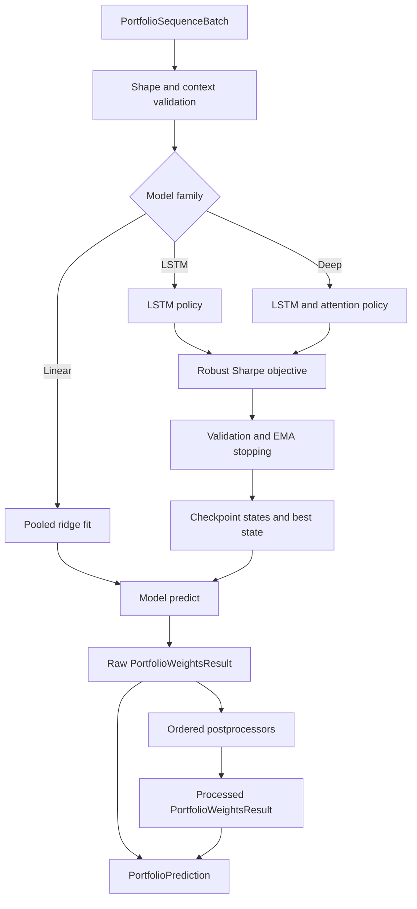

# Portfolio Learning and Allocation Workflow

The portfolio path turns a `PortfolioSequenceBatch` into one weight tensor per sequence window, date, and asset. The public composition boundary is `PortfolioAllocationPipeline`: it delegates fitting to one portfolio model, obtains the model's **raw** prediction, applies zero or more postprocessors in order, and returns both forms as a `PortfolioPrediction`. This separation matters: neural policies emit bounded signals, while exposure, concentration, and turnover rules are an optional downstream allocation step.

See [Model Families](../architecture/model-families.md) for the wider model taxonomy, [Contracts and Public API](../concepts/contracts-and-public-api.md) for common result contracts, [Training Runtime and Artifacts](../operations/training-runtime-and-artifacts.md) for persistence and observability, and [Data and Backtest Handoffs](../integrations/data-and-backtest-handoffs.md) for consuming the resulting allocations.

## End-to-end flow

*The allocation pipeline preserves model output as raw weights while separately carrying the final postprocessed allocation.*

## Batch contract and sequence semantics

`PortfolioSequenceBatch.features` has shape `(B, T, N, F)`: independent windows or samples, periods within each window, assets in stable cross-sectional order, and features. Returns, volatility scales, and availability masks use `(B, T, N)`; initial holdings use `(B, N)`. `group_ids` has one integer per asset, costs are canonicalized to `(N, 1)`, and the optional deep-model adjacency mask is `(N, N)`. Timestamps index `T`, while `asset_ids` identify and order `N`.

The supporting fields play different roles:

- `returns` are forward returns and are mandatory for fitting, but may be omitted for future prediction.
- `mask` denotes available asset-date positions. If absent, runtime helpers supply ones. Policies zero masked outputs, loss calculations exclude masked returns and turnover, and postprocessors leave unavailable positions at zero. Non-finite values outside the mask therefore do not contaminate portfolio returns.
- `vol_scale` defaults to one. The objective treats policy outputs as risk weights: it multiplies them by `vol_scale` when computing holdings changes and transaction costs, while gross return is the masked mean of `weights * forward_returns` across available assets.
- `prev_weights` seeds the first period's holdings for turnover and transaction costs; absent prior weights mean zero initial holdings. Later periods compare with the preceding period's volatility-scaled weights.
- `group_ids` and per-asset `costs` can enter the static neural context when `use_group_embedding` and `use_cost_in_context` are enabled. Validation requires the corresponding input when either option is active. Costs also independently enter the trading-cost term of the objective when supplied.
- `adjacency_mask` is used only by the deep policy's graph-attention stage. `True` blocks an attention edge. The implementation provides finite fallbacks for a fully blocked row, then relies on the availability mask to zero unavailable outputs.

The dataclass enforces dimensional agreement before a model runs. Neural training additionally requires train and validation batches to have the same asset count, feature count, and exact `asset_ids` order; the deep model also requires identical validation topology. If no validation batch is passed, the neural models deliberately reuse the training batch. The linear baseline requires returns, ignores `validation_batch`, and pools only positions with an active mask and finite features and returns.

## Three model paths

### Linear pooled baseline

`LinearFeaturePortfolioModel.fit` flattens all valid `(B, T, N)` observations into a pooled ridge regression from `F` features to forward returns. The optional intercept is not regularized. Prediction maps scores back to `(B, T, N)`, zeros unavailable assets, and immediately projects each cross-section to the configured gross exposure, net exposure, and optional per-asset cap. It exposes only checkpoint `1`.

This model is useful as a deterministic baseline, but its raw pipeline output is already normalized by the model itself. A pipeline postprocessor can still impose a different implementable constraint set.

### LSTM policy

`LSTMPortfolioPolicy` builds static context from asset embeddings plus optional group embeddings and costs. FiLM modulates features with that context, variable selection maps the feature axis into a latent representation, and an asset-wise LSTM processes each asset through time. Context-projected initial hidden and cell states make the recurrent path asset-aware. A `tanh` head bounds each raw signal to `[-1, 1]`, and the mask zeros unavailable positions.

### Deep policy

`DeepPortfolioPolicy` begins with the same context, FiLM, variable-selection, and asset-wise LSTM pattern. It then adds causal temporal self-attention, lagged cross-sectional attention, and—when an adjacency mask was fitted—adjacency-masked graph attention. A cross-sectional lag of `k` uses representations from `k` periods earlier as keys and values; a lag at least as long as the window uses zero history rather than wrapping around. Its final `tanh` head also produces bounded, masked raw weights.

The fitted deep topology is model state. Prediction may omit `adjacency_mask` to reuse it, but supplying a different topology is rejected. Both neural families also reject changed asset dimensions, feature dimensions, or asset identity/order at prediction.

## Neural objective

LSTM and deep models share `fit_policy_network` and `robust_sharpe_loss`. One optimization step computes policy weights for the entire training batch; `batch_size` only chunks policy forward passes to control memory, and the chunks are concatenated before one global loss and backward pass.

For each period, the loss:

1. masks unavailable positions;
2. computes gross return as the sum of `weight * forward_return`, divided by the number of available assets;
3. computes turnover from volatility-scaled current weights versus supplied initial holdings or the preceding scaled weights;
4. subtracts per-asset turnover cost `(gamma_cost * cost + turnover_penalty) * abs(change)`, again normalized by available-asset count; and
5. drops the first `burn_in` periods from Sharpe estimation, while retaining the full net-return tensor in the diagnostic output.

The objective combines two differentiable annualized Sharpe terms. `sharpe_pool` is calculated over all effective returns flattened across windows and periods. Each window also gets its own Sharpe; a numerically stable log-sum-exp soft minimum emphasizes weak windows. Training maximizes

`sharpe_pool + softmin_lambda * softmin_sharpe`

by minimizing its negative. `sharpe_eps` stabilizes variance division, `softmin_tau` controls soft-min sharpness, and `annualization_factor` supplies the square-root annualization. If neither costs nor a turnover penalty is active, net return reduces to gross return.

## Validation, checkpoints, and stopping

The neural runtime uses AdamW and evaluates at every `eval_every` step **and** at every scheduled checkpoint step. The schedule comes either from explicit `checkpoint_steps` or `checkpoint_every`; the configured `max_iters` step is included in the planned grid. Early stopping can prevent later planned checkpoints from being reached.

At each evaluation the runtime records the current train objective, pooled train Sharpe, and pooled validation Sharpe. Checkpoint-grid steps retain CPU-cloned state dictionaries. Independently, every strictly higher raw validation Sharpe updates `best_step` and an exact clone of that evaluated state. At completion, that best state is inserted into the checkpoint map even if its step was not on the regular grid, so it remains selectable and survives an early stop.

Stopping uses an exponential moving average of validation Sharpe, controlled by `metric_ema_alpha`. Once `early_stopping_burn_in_iters` is reached, an evaluation is bad unless the EMA is at least the current best raw validation Sharpe plus `metric_min_delta`; `early_stopping_patience` consecutive bad evaluations stop training. Best-state retention itself is based on the raw validation Sharpe, not the EMA. Consequently, checkpoint cadence, evaluation cadence, and stopping cadence are related but not identical.

Training fails fast rather than saving a corrupted state when any of these is non-finite:

- the training loss;
- any parameter gradient;
- the gradient norm returned by clipping;
- any parameter after `optimizer.step`; or
- pooled validation Sharpe.

Positive `max_grad_norm` enables clipping before the optimizer step. The model-level fit is atomic for neural state fields, so an exception does not leave a partially replaced fitted model. Training also raises if it somehow completes without an evaluated best state.

## Prediction and checkpoint selection

A neural prediction reconstructs the policy, loads a cloned retained state, switches to evaluation mode, and runs under `torch.no_grad()`. Selection precedence is:

1. an explicit `predict(..., checkpoint=step)`;
2. `config.default_checkpoint`; or
3. the greatest available retained step.

An explicit or configured step must actually exist in `available_checkpoints`; a planned step that was never reached because of early stopping is not valid. The returned `PortfolioWeightsResult` contains `(B, T, N)` float weights, the selected checkpoint step, timestamps, asset IDs, and model metadata. Prediction does not require returns.

## Raw versus processed allocation

`PortfolioAllocationPipeline.predict` keeps the model result as `raw_weights`, then passes the evolving result through each configured `PortfolioPostprocessor.transform(batch, weights)` in tuple order. With no postprocessors, raw and processed values are the same result object. This hook is the intended extension boundary for execution or mandate constraints without coupling them to model training.

`WeightConstraintPostprocessor` provides the built-in implementation:

- it projects every available cross-section jointly to requested gross and net exposure;
- it can impose `max_abs_weight`, rejecting constraint sets that the available assets cannot support;
- it rejects non-finite weights at available positions; and
- it optionally caps L1 turnover sequentially, beginning with `batch.prev_weights` or zero and carrying each constrained period into the next.

Turnover limiting scales the move from prior holdings toward the projected target. Because that scaling occurs after exposure projection, the final gross exposure can be below the requested target; the cap is preserved, but exact target exposure is not re-projected afterward. Consumers should therefore use `processed_weights` for the implementable allocation and retain `raw_weights` for diagnostics, attribution, or comparing policy behavior with constraint effects.

## Failure modes and safe-change checklist

- Supply forward returns for fitting and preserve `(B, T, N, F)` axis meaning; shape mismatches fail during batch construction.
- Keep asset IDs and order stable across neural train, validation, and prediction. For deep models, treat adjacency as fitted topology.
- When enabling group or cost context, populate the required batch fields in every train, validation, and prediction batch.
- Do not assume every configured future checkpoint exists after early stopping; inspect `available_checkpoints` or use the retained default/latest behavior.
- Distinguish policy risk weights from constrained allocation weights. Volatility scaling affects objective turnover, while the built-in postprocessor constrains the emitted weight tensor directly.
- Validate mandate feasibility, especially simultaneous gross, net, and per-asset caps under sparse availability.

Focused regression coverage lives in [`tests/test_portfolio.py`](../../tests/test_portfolio.py), [`tests/test_financial_correctness.py`](../../tests/test_financial_correctness.py), and [`tests/test_neural_components.py`](../../tests/test_neural_components.py). These tests cover model/checkpoint prediction, unlabeled future batches, raw-versus-processed results, exact best-state retention, chunk-size invariance, initial holdings and masked non-finite values, constraint feasibility, lag and graph-mask edge cases, early stopping, and all non-finite training guards.
