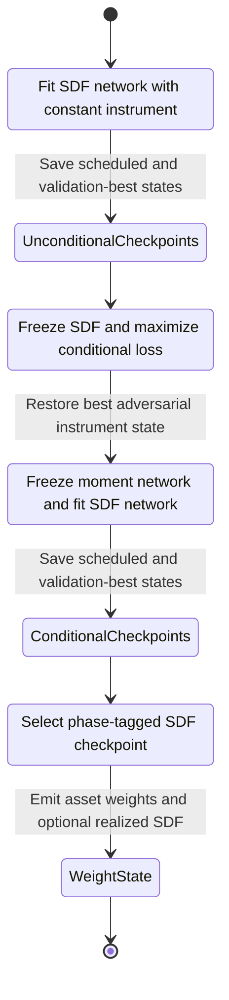

# Stochastic Discount Factor Training and Extraction

`StochasticDiscountFactorModel` learns dated cross-sectional portfolio weights whose realized portfolio return defines a stochastic discount factor (SDF). Its structural output is **weights**, not an expected-return forecast. Training proceeds through unconditional SDF fitting, adversarial instrument fitting, and conditional SDF fitting; extraction reconstructs a selected SDF-network checkpoint and emits a `StochasticDiscountFactorState`.

This workflow belongs to the latent-factor family but has a deliberately different output contract from a beta-times-lambda model. See [Model Families](../architecture/model-families.md) for family-level placement and [Contracts and Public API](../concepts/contracts-and-public-api.md) for shared result types.

## Inputs and invariants

The entry points are `fit(batch, validation_batch=None, patience=None)` and `extract(batch, checkpoint=None)`. Both consume a `CrossSectionBatch`:

- `characteristics` is required with shape `(T, N, L)`.
- `returns`, when present, has shape `(T, N)`. It is mandatory for training and for a validation batch. Extraction can omit it.
- `context_features`, when used, has shape `(T, C)`. A context-enabled model runs this sequence through an LSTM and tiles each dated state across assets before the feed-forward network.
- An optional `mask` has shape `(T, N)`. The effective SDF mask is the intersection of that mask, rows with finite characteristics, and—when returns are present—finite returns.

Training rejects a panel with no effective observations. Validation similarly rejects an empty effective panel. At extraction, the characteristic and context feature dimensions must exactly match those seen during fitting. If the fitted model used context, context is therefore required at extraction; if it did not, adding context is also rejected. The neural components independently enforce that an LSTM-enabled network receives context and that recurrent `h0` and `c0` are supplied together.

Invalid slots do not enter the learned weight vector or pricing moments. Returns and learned instruments outside the mask are replaced by zero before loss calculation. Extracted weights are expanded back to `(T, N)`, with `NaN` in masked slots.

## The three training phases

*The state flow shows which network is optimized in each phase and where extractable checkpoints are created.*

### 1. Unconditional SDF phase

For `n_epochs_unc` epochs, the model optimizes the SDF network with Adam using `lr` and `weight_decay`. Given valid flattened weights `w`, the dated SDF is

\[
m_t = 1 - \sum_i w_{t,i} r_{t,i}.
\]

The unconditional objective squares average asset-pricing moments based on `r × m` and a constant instrument. Asset moments are divided by each asset's valid-observation count and weighted by that count relative to the maximum count, so sparse assets contribute less while zero counts remain numerically safe. The reported training Sharpe is the mean divided by population standard deviation of the induced portfolio return `1 - m`; empty or non-finite results resolve to zero.

### 2. Adversarial moment-network phase

For `n_epochs_moment` iterations, the SDF network is in evaluation mode and its weights are computed without gradients. The moment network produces `n_instruments` bounded instrument panels from characteristics and optional context. Its optimizer minimizes `-conditional_loss`, thereby **maximizing** the squared conditional pricing errors and searching for instruments that expose SDF misspecification.

The implementation retains the moment-network state with the highest training conditional loss and restores it after the phase. This phase has no history entries and creates no extractable `("moment", epoch)` checkpoints; it prepares the fixed adversary used by the final phase.

### 3. Conditional SDF phase

For `n_epochs_cond` epochs, the restored moment network is fixed in evaluation mode and its instruments are computed without gradients. The SDF network then minimizes the conditional pricing loss based on `r × m × instrument`. As in the unconditional objective, observations are masked, each asset's moment is normalized by its valid count, and sparse assets receive count-based weighting.

The unconditional and conditional loops each use a phase-local epoch counter. Consequently, `burn_in_epochs` is reapplied at the start of both phases rather than consumed once across the complete run.

## Checkpoints, validation sentinels, and early stopping

### Scheduled phase-tagged checkpoints

Normal checkpoint keys are `(phase, phase_epoch)`, for example `("unconditional", 64)` or `("conditional", 512)`. A stored checkpoint contains CPU copies of both networks, although extraction reconstructs the SDF network only. `available_checkpoints` sorts unconditional keys before conditional keys and orders epochs within each phase.

The schedule is resolved once against `max(n_epochs_unc, n_epochs_cond)`:

- explicit `checkpoint_epochs` are filtered to valid epochs, deduplicated, sorted, and include the resolved maximum;
- otherwise a positive `checkpoint_interval` creates an interval grid and includes the maximum;
- with the configured default `checkpoint_interval=None`, only the maximum is scheduled.

A phase stores a scheduled checkpoint only when that epoch exists in its loop and `phase_epoch > burn_in_epochs`. This matters when phase lengths differ: a schedule resolved from the longer phase may provide no epoch for the shorter phase. With the shipped defaults—256 unconditional, 64 moment, 1024 conditional epochs, no interval, and no explicit epochs—only `("conditional", 1024)` is normally stored. Configure an interval or explicit epochs when intermediate or unconditional extraction is required.

### Validation-best sentinels

Supplying `validation_batch` evaluates the full validation panel after every post-burn-in epoch of each SDF phase. Four phase-tagged sentinel keys preserve independently best states:

| Meaning | Native key | Legacy integer alias |
|---|---:|---:|
| Unconditional minimum validation loss | `("unconditional", 0)` | `-1` |
| Unconditional maximum validation Sharpe | `("unconditional", -1)` | `-2` |
| Conditional minimum validation loss | `("conditional", 0)` | `-3` |
| Conditional maximum validation Sharpe | `("conditional", -1)` | `-4` |

Loss and Sharpe are independent criteria, so the two sentinels for a phase may point to different epochs. They are extractable like normal keys. They are not selected implicitly by the ordinary no-argument fallback, which prefers the last positive checkpoint.

`patience` applies separately to the unconditional and conditional loops and only when validation is supplied. A phase resets its counter whenever **either** validation loss improves or validation Sharpe improves; otherwise it increments the counter and stops that phase when the counter reaches `patience`. The counter is reset before conditional training. The moment phase always runs its configured iteration count.

### Selection precedence and compatibility

Extraction chooses checkpoints in this order:

1. the explicit `checkpoint` argument;
2. `config.default_checkpoint`;
3. the final positive key in sorted availability, normally the latest conditional checkpoint;
4. if no positive key exists, the final available sentinel.

A tuple is matched directly. Positive legacy integers map unconditional epoch `e` to `e` and conditional epoch `e` to `n_epochs_unc + e`; the negative aliases are shown above. Unknown keys fail rather than silently falling back.

`default_checkpoint` may be an integer or a `(phase, epoch)` tuple and is validated against configured phase lengths. However, configuration accepts a `("moment", epoch)` default while fitting does not create moment checkpoints, so that default cannot be selected successfully. Similarly, an aggressive burn-in or a schedule that misses a shorter phase can remove expected scheduled keys. Operators should verify `available_checkpoints` and ensure at least one post-burn-in SDF checkpoint exists. Artifact save/load preserves the phase-keyed checkpoint tree, dimensions, history, asset IDs, configuration, and fit record; malformed or empty checkpoint trees are rejected. See [Training Runtime and Artifacts](../operations/training-runtime-and-artifacts.md).

## Weight-native extraction

Extraction loads the chosen SDF-network state, switches it to evaluation mode, and predicts only valid slots. The returned `StochasticDiscountFactorState` contains:

- `asset_weights`: the `(T, N)` structural weight panel, with `NaN` outside the effective mask;
- `checkpoint_epoch`: the selected phase-tagged key;
- timestamps, asset IDs, and metadata identifying `native_output: "weights"` and all available checkpoints;
- `sdf_values` only when the extraction batch includes returns, computed as `1 - Σ(weight × return)` per date.

Thus returns are required to **realize** an SDF series but not to extract weights for a future characteristics panel. The configuration fixes `output_mode="weights"`; training rejects a non-weight-native mode. These weights must not be presented as beta-times-lambda latent-factor expected returns.

## Optional return and signal boundaries

Expected-return projection is deliberately separate. `LinearStochasticDiscountFactorReturnMapper.fit(state, batch)` requires realized returns and fits pooled least squares

\[
E[r_{t,i}] = intercept + slope \times weight_{t,i}
\]

using observations where both values are finite. With fewer than two finite observations it uses zero intercept and slope. `predict(state)` preserves `NaN` wherever weights are non-finite and returns an `AssetForecastResult`. The mapper must be fitted before prediction or persistence. This explicit boundary keeps model identification and a downstream forecasting assumption separate; see [Data and Backtest Handoffs](../integrations/data-and-backtest-handoffs.md).

`StochasticDiscountFactorBetaNetworkHead` is another optional consumer, but it is not the mapper and does not produce beta-times-lambda forecasts. It requires training returns plus an extracted state containing `sdf_values`, learns an asset-level signal against returns multiplied by the standardized realized SDF-portfolio return, and emits `AssetSignalResult`. Its own integer checkpoints and defaults are governed by the `beta_*` settings.

## Configured defaults

| Setting | Default | Role |
|---|---:|---|
| `state_dim_sdf` | `4` | SDF context-LSTM state width |
| `state_dim_moment` | `32` | moment-network context-LSTM state width |
| `hidden_dim` | `64` | SDF feed-forward hidden width |
| `n_instruments` | `8` | adversarial instrument count |
| `dropout` | `0.05` | network dropout probability |
| `n_epochs_unc` | `256` | unconditional SDF epochs |
| `n_epochs_moment` | `64` | adversarial iterations |
| `n_epochs_cond` | `1024` | conditional SDF epochs |
| `checkpoint_interval` | `None` | scheduled grid disabled except final maximum |
| `checkpoint_epochs` | `()` | no explicit schedule |
| `default_checkpoint` | `None` | use selection fallback |
| `burn_in_epochs` | `0` | phase-local epochs excluded from checkpoints and validation |
| `lr` | `1e-3` | both SDF and moment Adam learning rate |
| `weight_decay` | `0.0` | both optimizers' weight decay |

The configuration also controls `device`, `dtype`, and `seed` through the shared base config. Seeding occurs before network construction, making initialization and training reproducible for a fixed configuration and runtime.

## Failure-oriented test coverage

Focused tests establish the financial sign `m = 1 - Σ(wr)`, verify that non-finite values outside the mask cannot contaminate either loss, and exercise weight extraction with and without returns. Workflow tests cover phase-local burn-in, all four validation sentinels, default positive-checkpoint selection, legacy integer lookup, unknown-checkpoint rejection, context/feature compatibility, required returns, empty panels, mapper fit guards, and malformed persisted checkpoint trees. When changing scheduling, masking, or output semantics, these are the tests most likely to expose a contract regression.
